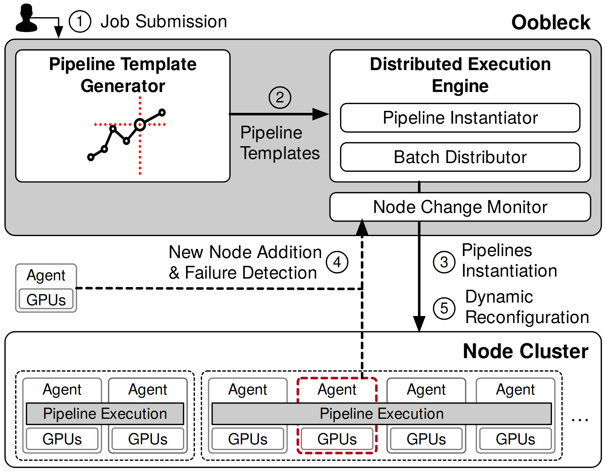

# VA-028 · 模板驱动执行与节点变化恢复

上方控制服务先生成执行模板，再实例化并分发任务；下方重复节点承载执行副本。节点新增或失效通过另一条反馈路径进入监控器，形成运行中重配置的说明，单个红色虚线节点是故障或变化事件的视觉焦点。



## 适用范围

- 任务模板可复用且需要运行中恢复的集群
- 展示正常部署路径与节点变化处理的系统

不适合：无节点变化的静态部署清单；将一次性模板生成误作每个请求都执行的流程。

## 阅读顺序

1. 从左上用户入口及编号 1 开始。
2. 读控制区内模板生成到执行引擎的编号 2。
3. 沿向下路径查看执行副本和节点资源。
4. 返回虚线监控路径，理解新增节点、变化检测及重配置。

## 图形表达

**布局**：上方通栏控制区，下方通栏节点池，中间留出部署与反馈走线；生成器和引擎在控制区左右分列。

**对象**：小依赖图代表生成结构，内层条块代表引擎职责，底部重复框组合为不同规模副本。

**连线**：实线箭头承载模板和实例化；虚线反馈突出事件上报，不能当数据主路径。

**配色**：主图灰白，红色只标变化节点及生成器内部强调；不要将全部运行节点涂红。

**文字**：控制区标题加粗，执行阶段和节点小标签较细；编号紧贴步骤线而不贴节点编号。

## 部件与复用

| 部件 | 含义 | 改造方法 |
|---|---|---|
| 执行模板生成 (`template-generator`) | 将任务依赖组织成可实例化结构。 | 重绘小依赖图为真实任务关系，不能仅改标题保留不相关结构。 |
| 执行与监控引擎 (`execution-engine`) | 包含实例化、批次分发和变化监控。 | 根据系统职责替换三个内层模块，保持监控与部署相连。 |
| 新增资源节点 (`new-node`) | 主节点池之外的新增资源示意。 | 可改为扩容设备，但要与失效节点区别，不暗示二者同一事件。 |
| 执行副本群 (`replica-cluster`) | 底部多组节点共同承载任务执行。 | 按真实副本与流水线划分调整边界，不把不同长度组误作相同规模。 |

## 改造步骤

1. 区分离线生成模板与运行期实例化。
2. 决定红色框表示故障、加入还是迁移，并给出唯一解释。
3. 新场景若没有容错阈值，不继承任何副本数量要求。
4. 节点数量变化须同步改变跨节点执行条和外框。

## 新情景示例（假设）

假设绘制灾害模拟集群的容错调度。

生成器建立子域计算模板，引擎分派批次，节点池承载区域模拟，监控器处理计算节点失效。

将底部执行条按子域副本重画，保留一个红框故障节点并增补重新分配目的地。

## 编辑入口

**入口**：运行 make_figure.py，以 example.json 为改造配置；labels.json 查文字键，--parts 同步导出部件。

**配置可改**：labels 改文字，components 改显示、位移及样式，elements 改单个矢量属性；只选一个部件层级移动，避免重叠归属使对象移动两次。

**需改代码**：这是可编辑矢量结构，未实现自动布局。增删模块、改变连接或重新排版，须在 customize() 中改真实对象并更新部件成员。

**字体**：使用随包完整映射字体；改字后核查换行、符号和最终纸面字号。font_size 是对象局部单位，不能直接当作 PDF 的磅值。

准备独立工作副本：

```text
python "<SKILL>/scripts/prepare_architecture.py" --id VA-028 --out figures/architecture
```

在工作副本运行：

```text
python make_figure.py --config example.json --out . --parts
python render_architecture.py fig.svg
```

## 本图检查

- 用户入口是否仍位于左上而非误写为左下。
- 变化检测虚线是否准确指向监控器。
- 副本边界、节点数与横跨执行条是否一致。

部件图用于复用局部对象；跨边界的连接和共享容器仍需按新关系处理。示例名称、数值和曲线不是当前研究结果。

来源与许可见 [ATTRIBUTION.md](ATTRIBUTION.md)。
