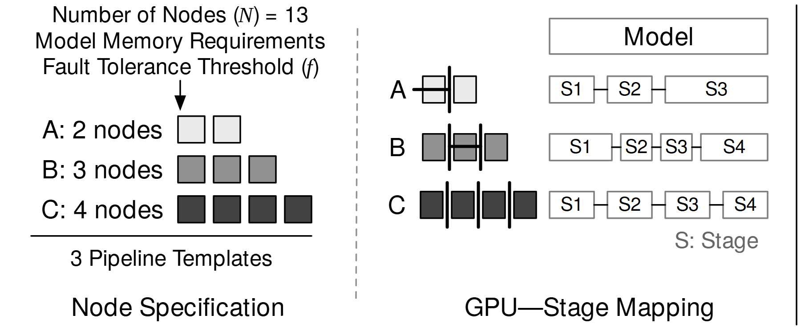

# VA-185 · 异构资源模板与阶段映射

左右两栏把资源数量的抽象模板对应到具体阶段划分。左侧三种灰阶方块以数量区分节点预算，右侧保持同一 A/B/C 行序，用节点分隔线和阶段长条解释映射。此资源仅含模板生成片段，没有候选实例化方案或最优方案输出。



## 适用范围

- 同一任务在不同资源预算下的分段策略
- 模型切分、生产批次与设备分配的候选模板比较

不适合：需要展示搜索算法、候选排名和最终选优的完整流程；资源之间任意互连的网络拓扑。

## 阅读顺序

1. 先读左上节点总数、内存需求与容错阈值，理解示例约束。
2. 按 A、B、C 三行比较左侧 2、3、4 个灰阶节点。
3. 跨过竖向虚线后按同一行读 GPU 分组及右侧 S1 等阶段块。
4. 用右上 Model 总条和右下 Stage 注释解释分段对象；此处没有实例化阶段。

## 图形表达

**布局**：竖向虚线分出规格与映射两栏；A/B/C 行水平对齐，右侧模型总条位于阶段行上方。

**对象**：实心小方块表示资源单位，竖直短线表示分组边界；空心长条表示模型阶段，其宽度随示例划分变化。

**连线**：左上约束以向下箭头进入资源清单；右侧阶段短线只连接同一行，不能误当作跨模板通信。

**配色**：浅灰、中灰、深灰分别贯穿 A/B/C，同一行资源同色；阶段条保持白底黑边。

**文字**：主标签为无衬线，变量 N、f 和阶段符号带数学斜体；底部两栏标题大于阶段文字。

## 部件与复用

| 部件 | 含义 | 改造方法 |
|---|---|---|
| 资源约束 (`planning-inputs`) | 给出候选模板共享的预算和约束。 | 按新问题替换总预算和约束，保留下行输入箭头。 |
| 三种节点模板 (`node-templates`) | 以节点数和灰阶区分三种可复用资源规格。 | 增删方块时同步修改 A/B/C 标签及对应映射行。 |
| 节点内阶段分组 (`gpu-grouping`) | 分隔竖线与方块组合把节点配置转为分组方式。 | 改变节点或阶段数量需重画分隔与方块间距。 |
| 模型阶段条组 (`stage-mapping`) | 用总模型条和三行阶段条显示切分方案。 | 按已计算的分段比例改变宽度，不将示例宽度当作结果。 |

## 改造步骤

1. 先确定新场景比较的是资源预算还是切分方式，并替换左上约束。
2. 同时编辑左右 A/B/C 三行，确保颜色、资源数与阶段名称一一对应。
3. 若需要展示候选组合与最优选择，应新增独立右侧面板；当前图不提供该部分。
4. 资源数或阶段数变化时在 customize 中重排节点、分隔线与条形宽度。

## 新情景示例（假设）

假设场景：应急仓储的三种分拣线配置。

灰阶节点映射为设备组，S1–S4 映射为验收、分拣、复核和装车工序。

把设备组数量与工序负载重新计算；若比较总成本，新增结果面板并引用独立求解数据。

## 编辑入口

**入口**：make_figure.py 为本图定制入口；example.json 配置一次生成；labels.json 定位文字；asset.json 保存部件及其元素成员。运行 python make_figure.py --config example.json --out . --parts。

**配置可改**：labels、components 可修改文字、配色、显隐与位移；它们不会根据新标签长度自动重排，也不会重算图中示意数值。

**需改代码**：拓扑、对象数量和跨部件连接在 customize(root, context) 中编辑。新增对象设 data-asset-key 并更新对应部件 element_keys；跨区域连线默认留在整图，移动部件后需重接；有重叠部件时避免重复位移同一元素。

**字体**：主标签为无衬线，变量 N、f 和阶段符号带数学斜体；底部两栏标题大于阶段文字。 最终字体文件以构建映射为准；源坐标的局部 font_size 不等于论文纸面 pt，需按最终插图宽度复核。本批构建已确认并嵌入完整字体：Tinos-Italic.ttf, texgyreheros-regular.otf。映射可能改变原字形和字宽，需按实际论文尺寸复核。

准备独立工作副本：

```text
python "<SKILL>/scripts/prepare_architecture.py" --id VA-185 --out figures/architecture
```

在工作副本运行：

```text
python make_figure.py --config example.json --out . --parts
python render_architecture.py fig.svg
```

## 本图检查

- 左右 A/B/C 是否保持同序同色。
- 方块数量是否等于所写的资源数。
- 阶段条宽度是否被误读为未经验证的性能比例。
- 文字或箭头是否越过中间虚线；最右侧残留竖线在新排版中是否需要移除。

部件图用于复用局部对象；跨边界的连接和共享容器仍需按新关系处理。示例名称、数值和曲线不是当前研究结果。

来源与许可见 [ATTRIBUTION.md](ATTRIBUTION.md)。
