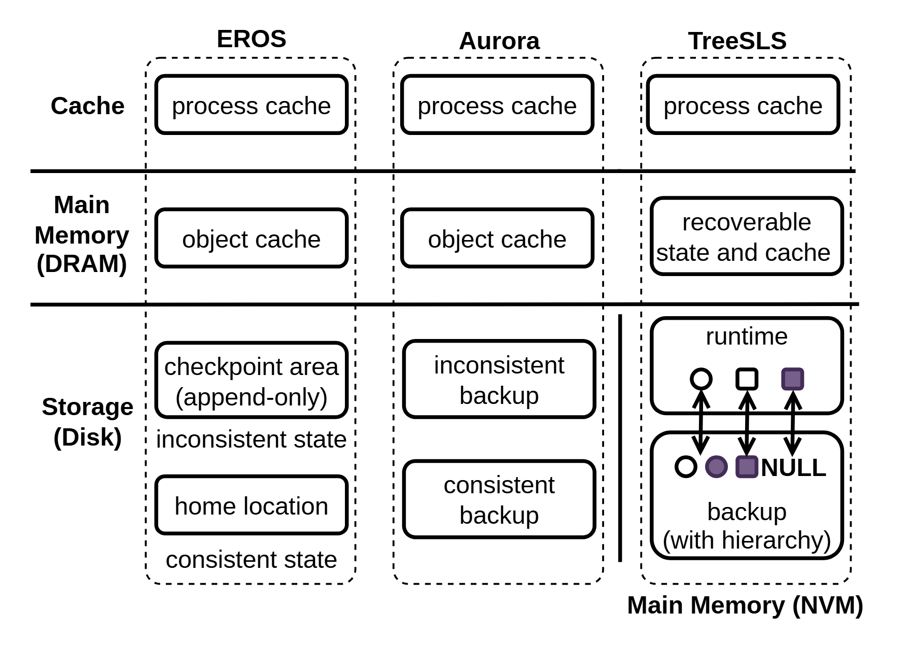

# VA-102 · 共享层级下的三方案状态组织比较

三列方案共用缓存、内存与存储等横向层级，列内盒子展示状态分别放在哪里。右列下部进一步用小节点和双向箭头解释运行状态与备份的对应关系。共享横线提供比较基准，只有在方案层级确实可比时，才能用较少的盒子说明结构合并。



## 适用范围

- 三种状态组织或恢复架构对照
- 同一资源层次下的方案差异

不适合：性能柱状对比；层级含义完全不同的三个系统。

## 阅读顺序

1. 先读左侧共享层级名称
2. 逐行比较三列各自存放的状态
3. 再逐列检查缓存与持久状态如何划分
4. 最后放大右下运行节点到备份节点的映射

## 图形表达

**布局**：三列虚线圆角范围并排，实横线跨列划分层级；右列底部容纳更细的对象对应示意。

**对象**：圆角矩形表示状态区域，圆形与方形是不同对象符号，空心、填色和NULL标签展示状态差异。

**连线**：大部分结构靠包含和对齐表达，右下短双向箭头只用于对象映射；横向分隔线不是通信总线。

**配色**：整体黑白，少量紫色填充强调存在的状态节点；不将紫色解释为更快或更优。

**文字**：无衬线列标题加粗，左侧层级标签分行，列内长状态名也应分行以保持三列宽度平衡。

## 部件与复用

| 部件 | 含义 | 改造方法 |
|---|---|---|
| 第一方案列 (`scheme-a`) | 缓存、对象状态、追加检查点和稳定位置分开组织。 | 替换为方案一的实际状态划分，保留哪些数据已一致的说明。 |
| 第二方案列 (`scheme-b`) | 缓存与两类备份状态分开组织。 | 用明确恢复语义命名两个备份区，不只称主副本。 |
| 第三方案列 (`scheme-c`) | 合并可恢复状态并展示运行与层次备份。 | 不能用较少模块暗示性能优势，需说明合并的技术前提。 |
| 状态映射细节 (`hierarchical-backup`) | 小节点从运行结构映射到备份结构，含空节点或空引用。 | 为圆方形、填色与NULL给出当前数据结构的定义。 |

## 改造步骤

1. 先建立所有方案可共用的层级轴，再画列内对象
2. 统一比较粒度，不能一列按库一列按字段
3. 若新方案跨越层级，需要显式标明介质或职责改变
4. 增删方案列要同步延长横线并调整左侧标签位置

## 新情景示例（假设）

可用于比较三种仿真任务的断点恢复方案。

三列对应日志回放、全量快照、分层增量快照；共享行对应进程缓存、内存状态和持久记录。

重写各列状态区，把右下细节改为真实快照对象引用；若没有持久内存，不保留介质合并示意。

## 编辑入口

**入口**：make_figure.py 读取 example.json；labels.json 查文字键，asset.json 查部件键；输出 SVG，可用配套渲染脚本导出 PDF。

**配置可改**：labels 修改文字及字体属性；components 可设 visible、dx/dy、attributes；elements 修改单个对象属性。平移使用图的坐标单位，重叠部件不要同时平移。

**需改代码**：改变模块数量、连接关系或分栏布局须编辑 customize()，不会自动布线。新对象需唯一 data-asset-key，并加入对应部件 element_keys，才会随部件导出。

**字体**：本图映射字体：Arimo-Bold.ttf, Arimo-Regular.ttf。沿用完整字体覆盖新字符；font_size 是元素局部单位，不是纸面 pt。改长标签后检查字宽、裁切及最终 PDF。

准备独立工作副本：

```text
python "<SKILL>/scripts/prepare_architecture.py" --id VA-102 --out figures/architecture
```

在工作副本运行：

```text
python make_figure.py --config example.json --out . --parts
python render_architecture.py fig.svg
```

## 本图检查

- 三列的横向层级是否真正可比
- 一致与未完成状态标签是否准确
- 右下对象映射及空引用是否符合实际数据结构

部件图用于复用局部对象；跨边界的连接和共享容器仍需按新关系处理。示例名称、数值和曲线不是当前研究结果。

来源与许可见 [ATTRIBUTION.md](ATTRIBUTION.md)。
