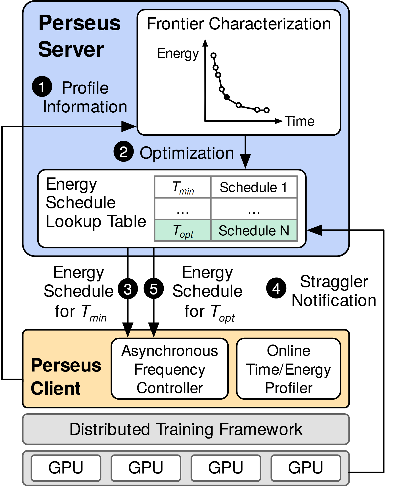

# VA-186 · 查表调度与硬件反馈闭环

蓝色服务端先计算时间与能耗前沿并缓存调度表，黄色客户端执行表项，底部硬件反馈可再次触发选择。1–5 编号把跨层往返组织成一个阅读顺序，既展示在线控制，也把决策依据画成可见的数据对象。



## 适用范围

- 服务端生成策略、客户端执行且硬件回报异常的闭环
- 离线计算可行前沿后在线查表选择的资源管理

不适合：只需要一条单向数据管线；没有查表策略或硬件反馈的普通客户端服务器部署。

## 阅读顺序

1. 由左侧①剖析信息进入服务端右上的前沿曲线。
2. 沿②优化下行到调度查找表，观察绿色突出的一行。
3. 按③初始调度下发到客户端的频率控制器。
4. 从硬件右侧沿④延迟通知返回表格，再沿⑤下发更新策略。
5. 最后将客户端、框架和 GPU 三层对应到执行责任。

## 图形表达

**布局**：窄竖幅图自上而下为大服务端、反馈通道、客户端、框架与硬件条；外侧折线路由绕过层级。

**对象**：圆角大框包住责任域，服务端内含折线散点小图和二维表，底部重复 GPU 小框表示多设备。

**连线**：①和④走左右外围回路；③⑤为并排下行箭头，不能因方向相同而合并成一次交互。

**配色**：浅蓝是服务端，浅黄是客户端，灰色是框架及硬件；浅绿表项表示被强调的策略而非客户端颜色。

**文字**：系统域标题为粗无衬线，模块标签为普通无衬线，Tmin/Topt 使用数学下标；黑实心步骤圆标留足反白空间。

## 部件与复用

| 部件 | 含义 | 改造方法 |
|---|---|---|
| 时间能耗前沿 (`frontier`) | 用小型坐标图解释调度候选的权衡依据。 | 替换轴意义与前沿点；有真实数值时通过数据重新生成曲线。 |
| 可选调度表 (`schedule-table`) | 将目标时间对应到缓存的策略条目。 | 增减表行并同步突出当前策略；长策略名需扩列。 |
| 客户端执行器 (`client-controls`) | 把执行调度与在线测量放在共同责任域内。 | 按真实部署替换两个功能模块，保留分工。 |
| 执行框架与设备 (`framework-devices`) | 用框架总条和重复设备建立软件与硬件的层级关系。 | 调整设备数量或换为机器人、节点等实体并重接右侧反馈。 |

## 改造步骤

1. 先明确新系统的控制量、测量量与触发更新的异常。
2. 用实际可行域重画前沿；表项只填已定义的策略，不把示意曲线当实验结果。
3. 按真实消息先后重编①–⑤，尤其区分首次下发和异常后下发。
4. 改变硬件或模块宽度后手工重接外围折线及两条下行箭头。

## 新情景示例（假设）

假设场景：楼宇空调的云端节能调度。

前沿表示舒适度与电耗折中；表格为温度目标对应控制策略；客户端为楼控，GPU 变为空调机组。

将延迟通知改为温度偏差反馈，重新定义两次下发的触发条件并以仿真数据生成前沿。

## 编辑入口

**入口**：make_figure.py 为本图定制入口；example.json 配置一次生成；labels.json 定位文字；asset.json 保存部件及其元素成员。运行 python make_figure.py --config example.json --out . --parts。

**配置可改**：labels、components 可修改文字、配色、显隐与位移；它们不会根据新标签长度自动重排，也不会重算图中示意数值。

**需改代码**：拓扑、对象数量和跨部件连接在 customize(root, context) 中编辑。新增对象设 data-asset-key 并更新对应部件 element_keys；跨区域连线默认留在整图，移动部件后需重接；有重叠部件时避免重复位移同一元素。

**字体**：系统域标题为粗无衬线，模块标签为普通无衬线，Tmin/Topt 使用数学下标；黑实心步骤圆标留足反白空间。 最终字体文件以构建映射为准；源坐标的局部 font_size 不等于论文纸面 pt，需按最终插图宽度复核。本批构建已确认并嵌入完整字体：texgyreheros-bold.otf, texgyreheros-italic.otf, texgyreheros-regular.otf。映射可能改变原字形和字宽，需按实际论文尺寸复核。

准备独立工作副本：

```text
python "<SKILL>/scripts/prepare_architecture.py" --id VA-186 --out figures/architecture
```

在工作副本运行：

```text
python make_figure.py --config example.json --out . --parts
python render_architecture.py fig.svg
```

## 本图检查

- ①与④是否分别从测量和硬件事件进入正确目标。
- ③⑤是否确实代表不同阶段而非重复画线。
- 曲线、表格与下标是否在最终窄栏宽度下清楚。
- 客户端色为浅黄；绿色只用于表项，不混淆职责。

部件图用于复用局部对象；跨边界的连接和共享容器仍需按新关系处理。示例名称、数值和曲线不是当前研究结果。

来源与许可见 [ATTRIBUTION.md](ATTRIBUTION.md)。
