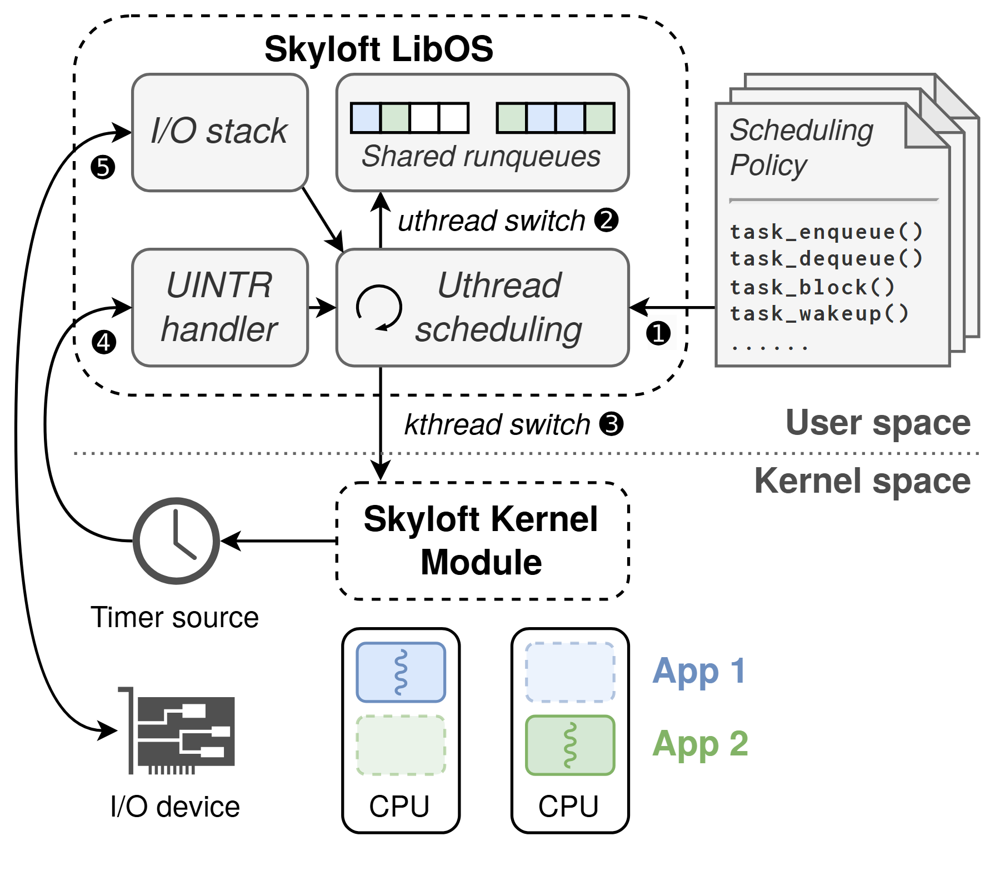

# VA-187 · 用户态调度器与内核事件协同

图以用户态与内核态的水平虚线分界，主调度器置于用户态容器内，右侧策略文档作为可插拔输入，左侧计时器与设备以长弧线送回事件。底部双 CPU 的蓝绿块说明应用线程状态，使接口、事件和执行位置能够在同一图里追踪。



## 适用范围

- 用户态控制与内核/硬件事件配合的运行时
- 可替换策略驱动共享队列和多核执行的调度系统

不适合：所有步骤位于单一进程的线性算法；需要精确时序、竞态或中断延迟量化的图。

## 阅读顺序

1. 读右侧策略文档，经①进入用户态调度器。
2. 沿②向上读共享队列，再经③向下跨越用户/内核分界。
3. 从内核模块读向左的计时器设置，再跟随④返回中断处理器。
4. 沿⑤查看设备与 I/O 栈的外围连接。
5. 最后对照底部两颗 CPU 与蓝绿应用图例，区分实线活跃块和虚线淡色块。

## 图形表达

**布局**：用户态容器占左上大区，策略文档靠右；内核模块在中下居中，计时器和 I/O 设备靠左，CPU 在底部成对排列。

**对象**：虚线圆角框表示软件边界，叠页形表示策略接口，时钟和电路卡表示外部事件源，CPU 内的小块展示应用状态。

**连线**：短直箭头连接队列与调度器；跨层箭头穿过水平边界；设备与计时器事件用外缘弧线返回，不应截断成互不相关小图。

**配色**：软件主体为灰白，蓝色和绿色仅用于两种应用及队列占位；淡色虚线块表示不同状态，不能只以颜色代替状态解释。

**文字**：容器标题粗体，用户功能多为斜体，策略接口是等宽代码风格；小黑圈编号需保持可辨认。

## 部件与复用

| 部件 | 含义 | 改造方法 |
|---|---|---|
| 用户态事件接收器 (`event-handlers`) | I/O 与用户中断两个入口将异步事件送入调度。 | 保持两个入口含义不同，新增事件类型需增框并接调度器。 |
| 共享运行队列 (`runqueues`) | 彩色条格记录不同应用的待执行线程。 | 按应用类别修改颜色并与底部图例保持一致。 |
| 用户线程调度器 (`scheduler`) | 中心循环符号强调持续调度而非一次性函数。 | 替换调度过程时保留或移除循环符号并更新跨层出口。 |
| 可插拔策略接口 (`policy`) | 叠页加函数名表明多策略可替换接口。 | 用新接口名替换整行代码，不直接逐字拉伸。 |
| 内核辅助模块 (`kernel-module`) | 承担跨应用内核线程切换并设置计时器。 | 只保留真实需要特权的能力，不把整套用户调度器搬入框。 |
| 时钟与设备 (`event-sources`) | 两个不同图标提供计时与 I/O 的事件来源。 | 可拆换图标但回调长弧线仍在整图中重新定位。 |
| 双核与应用状态 (`cpu-apps`) | 两颗 CPU 对照展示不同应用的活跃/待切换状态。 | 增删 CPU 时复制内部状态组并移动图例。 |

## 改造步骤

1. 先确定用户态和内核态的真实责任边界，再决定哪些模块可以跨界迁移。
2. 同步替换策略代码、队列颜色与 CPU 内应用示例。
3. 用新的事件源替换左侧硬件；保留设置计时器与接收中断的方向差别。
4. 数量变化通过 customize 增减队列格、CPU 和长弧线；配置位移不会自动修复跨层连线。

## 新情景示例（假设）

假设场景：机器人运行时的用户态任务调度。

策略文档映射为任务优先级接口，I/O 栈为传感事件，计时器为周期任务，蓝绿块为导航与避障线程。

若执行硬件只一颗核则删除第二 CPU，按真实中断路径重画返回弧线；不宣称延迟改进。

## 编辑入口

**入口**：make_figure.py 为本图定制入口；example.json 配置一次生成；labels.json 定位文字；asset.json 保存部件及其元素成员。运行 python make_figure.py --config example.json --out . --parts。

**配置可改**：labels、components 可修改文字、配色、显隐与位移；它们不会根据新标签长度自动重排，也不会重算图中示意数值。

**需改代码**：拓扑、对象数量和跨部件连接在 customize(root, context) 中编辑。新增对象设 data-asset-key 并更新对应部件 element_keys；跨区域连线默认留在整图，移动部件后需重接；有重叠部件时避免重复位移同一元素。

**字体**：容器标题粗体，用户功能多为斜体，策略接口是等宽代码风格；小黑圈编号需保持可辨认。 最终字体文件以构建映射为准；源坐标的局部 font_size 不等于论文纸面 pt，需按最终插图宽度复核。 圈号专用 DejaVuSans 修复已写入工作源副本。本批构建已确认并嵌入完整字体：Arimo-Regular.ttf, DejaVuSans.ttf, Inconsolata-Bold.ttf, texgyreheros-bold.otf, texgyreheros-italic.otf, texgyreheros-regular.otf。映射可能改变原字形和字宽，需按实际论文尺寸复核。

准备独立工作副本：

```text
python "<SKILL>/scripts/prepare_architecture.py" --id VA-187 --out figures/architecture
```

在工作副本运行：

```text
python make_figure.py --config example.json --out . --parts
python render_architecture.py fig.svg
```

## 本图检查

- ③跨界是否仍指向内核模块。
- ④计时器中断与⑤设备事件是否接到不同入口。
- 政策接口代码是否等宽且没有碰到叠页边界。
- 蓝绿队列格与底部应用名是否一致，虚线状态是否仍可识别。

部件图用于复用局部对象；跨边界的连接和共享容器仍需按新关系处理。示例名称、数值和曲线不是当前研究结果。

来源与许可见 [ATTRIBUTION.md](ATTRIBUTION.md)。
