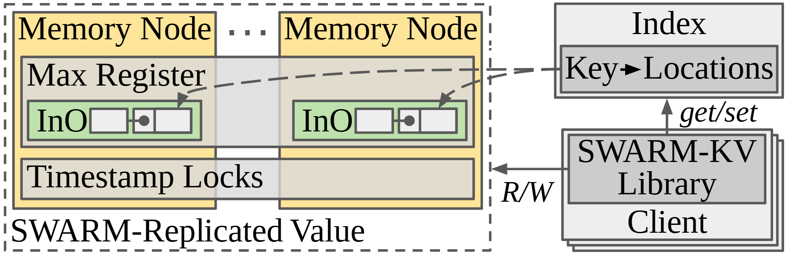

# VA-029 · 索引定位与分散副本的直接访问

右侧客户端通过位置索引找到对象所在节点，再访问左侧副本组。左侧多个节点共享同一复制对象的边界，但每个节点保留独立内部状态。跨节点的状态层强调协调要求，索引定位与数据读写在图上分成两条关系。



## 适用范围

- 目录服务与分散数据存储解耦
- 需要同时展示副本位置和节点内状态

不适合：无复制关系的分片总览；要完整解释一致性协议时序。

## 阅读顺序

1. 从右下客户端开始，向上读取键到位置的索引。
2. 沿定位虚线辨认左侧多个副本位置。
3. 再看客户端指向副本组的读写路径。
4. 进入节点内状态框，并核对底部跨节点协调层。

## 图形表达

**布局**：左侧宽副本区，右上索引、右下客户端；整体扁宽，适合双栏中的横向插图。

**对象**：节点用嵌套矩形表示，副本组外加虚线边界，客户端叠片表示多个调用者。

**连线**：定位虚线连接目录与节点位置；客户端到目录的箭头表示索引操作，到副本区的箭头表示读写。

**配色**：浅黄区分节点背景，绿色突出节点内访问状态，灰色用于目录、客户端和协调状态；同色不等于同一物理内存。

**文字**：大号衬线对象名形成紧凑结构，操作名带斜体；替换长接口名时优先扩大右栏。

## 部件与复用

| 部件 | 含义 | 改造方法 |
|---|---|---|
| 副本范围 (`replica-group`) | 多个节点共同保存同一逻辑对象。 | 明确是复制还是分片，后者应更换整体语义。 |
| 节点状态 (`node-registers`) | 每个节点内有独立访问寄存器与槽位。 | 按实际元数据替换，不保留无用状态缩写。 |
| 协调状态层 (`timestamp-layer`) | 时间或锁状态跨副本范围展示。 | 说明逻辑协调，并不默认集中物理存储。 |
| 位置目录 (`directory`) | 对象键映射到一个或多个位置。 | 更换键和地址结构时同步改定位线。 |
| 客户端集合 (`client-stack`) | 多个调用者先定位再访问。 | 可缩减为单客户端，但须删除叠片。 |

## 改造步骤

1. 先确定对象、节点、副本三者关系。
2. 区分位置元数据的访问和内容数据的读写。
3. 若要表达一致性强度，增加已验证条件，不能从箭头推断。

## 新情景示例（假设）

可用于多仓库存目录与副本查询。

目录映射为货品到仓库的位置表，节点状态映射为仓库库存记录，客户端映射为订单服务。

库存更新通常不等于内存原子寄存器，应替换内部结构与底部协调规则。

## 编辑入口

**入口**：运行 make_figure.py；example.json 为配置，labels.json 查文字键，asset.json 查部件。使用 --parts 导出独立矢量部件。

**配置可改**：labels 可改文字及字体；components 可设置 visible、dx/dy、attributes；elements 可按键改图元属性。移动量使用整图 viewBox 单位，重叠部件只选一个层级移动。

**需改代码**：增删节点、调整连接和重排结构须在 customize() 中处理；新增图元使用唯一 data-asset-key，并登记至相应部件 element_keys。配置不会自动排版。

**字体**：本图使用 Arimo-Regular.ttf、Tinos-Italic.ttf、Tinos-Regular.ttf。font_size 是图元局部坐标单位，受既有缩放影响，不等于纸面 pt；改字后检查实际字宽与最终阅读尺寸。

准备独立工作副本：

```text
python "<SKILL>/scripts/prepare_architecture.py" --id VA-029 --out figures/architecture
```

在工作副本运行：

```text
python make_figure.py --config example.json --out . --parts
python render_architecture.py fig.svg
```

## 本图检查

- 目录虚线是否连接到位置对象而非整个节点标题。
- 复制组边界是否漏包一个副本。
- 修改协调层后是否误画成所有节点共享同一物理锁。

部件图用于复用局部对象；跨边界的连接和共享容器仍需按新关系处理。示例名称、数值和曲线不是当前研究结果。

来源与许可见 [ATTRIBUTION.md](ATTRIBUTION.md)。
