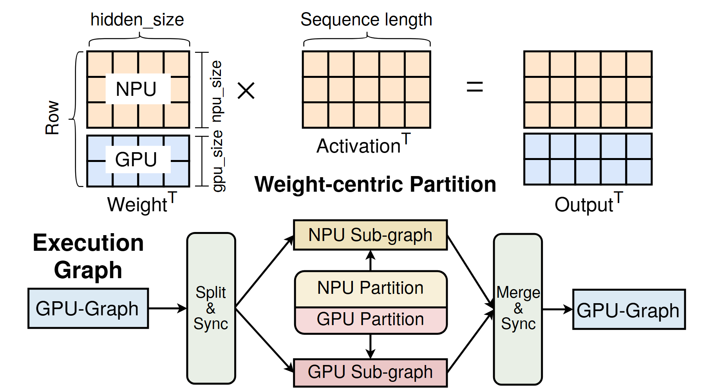

# VA-068 · 矩阵分区与异构执行对应

上半部用矩阵乘法展示按行分配工作，下半部展示拆分、同步、并行子图与合并。两层共同回答“拆什么”和“怎样执行”，适合把数学划分与系统实现对应起来；各颜色映射必须人工核对，不能只依赖上游文字描述。



## 适用范围

- 矩阵或数据块划分对应多设备执行
- 需要解释分区计算如何恢复单一路径的方法

不适合：不具备可分块关系的任务；仅展示设备列表而没有计算依赖的部署图。

## 阅读顺序

1. 先读左上被分为两组行的权重矩阵。
2. 看乘号、激活矩阵与右上分区输出，核对维度。
3. 转到下半部入口和拆分同步点。
4. 跟随上下并行支路到合并同步，再回到单一出口。

## 图形表达

**布局**：上下两层，上层数学等式，下层对称分叉合流；中心分区框连接两种理解。

**对象**：网格表示矩阵元素组，长圆角框表示同步边界，小矩形表示执行子图。

**连线**：下方实线箭头表达依赖，并行分支不意味着耗时相等；乘号等号属于数学关系。

**配色**：上部橙色和蓝色分配两类计算；下部第二支当前为粉色，迁移时应统一对应颜色并补图例。

**文字**：维度标注和转置上标是数学信息，不能当普通标题替换；执行图标题较粗以区分层次。

## 部件与复用

| 部件 | 含义 | 改造方法 |
|---|---|---|
| 行分块权重 (`partitioned-weight`) | 同一矩阵按行交给两类资源。 | 替换资源名和行数，保留划分方向，不能把行切分写成列切分。 |
| 矩阵运算与输出 (`matrix-operation`) | 公共输入参与运算，结果保持对应分块。 | 依据新问题重算维度和转置，方格数量只作示意需注明。 |
| 拆分同步入口 (`split-sync`) | 单一路径在此进入分区执行。 | 说明拆分的是数据、图还是任务，并设置真实同步条件。 |
| 并行计算分支 (`parallel-subgraphs`) | 两个子图和中央分区表示异构分工。 | 改为实际设备与子任务；统一与上方矩阵的配色。 |
| 合并同步出口 (`merge-sync`) | 合并两个部分输出并恢复后续执行。 | 写清拼接、求和或归约，不默认所有合并运算相同。 |

## 改造步骤

1. 先写出真实矩阵公式，再设置分区图。
2. 逐层检查相同颜色是否代表同一种资源。
3. 如果分支数量改变，同步重画矩阵分块与下层拓扑。
4. 合并算子必须与上方输出分区一致。

## 新情景示例（假设）

假设绘制两设备协同图像批处理。

上方行块改为两组图像批次，下方为两设备并行特征提取。

这时不再成立的矩阵乘法需要改成批次拆分示意；出口用批次拼接而非保留等式。

## 编辑入口

**入口**：运行 make_figure.py，以 example.json 为改造配置；labels.json 查文字键，--parts 同步导出部件。

**配置可改**：labels 改文字，components 改显示、位移及样式，elements 改单个矢量属性；只选一个部件层级移动，避免重叠归属使对象移动两次。

**需改代码**：这是可编辑矢量结构，未实现自动布局。增删模块、改变连接或重新排版，须在 customize() 中改真实对象并更新部件成员。

**字体**：使用随包完整映射字体；改字后核查换行、符号和最终纸面字号。font_size 是对象局部单位，不能直接当作 PDF 的磅值。

准备独立工作副本：

```text
python "<SKILL>/scripts/prepare_architecture.py" --id VA-068 --out figures/architecture
```

在工作副本运行：

```text
python make_figure.py --config example.json --out . --parts
python render_architecture.py fig.svg
```

## 本图检查

- 矩阵内维度及转置是否数学相容。
- 下方蓝粉差异是否已统一或清楚解释。
- 合流后结果顺序是否与原分区一致。

部件图用于复用局部对象；跨边界的连接和共享容器仍需按新关系处理。示例名称、数值和曲线不是当前研究结果。

来源与许可见 [ATTRIBUTION.md](ATTRIBUTION.md)。
