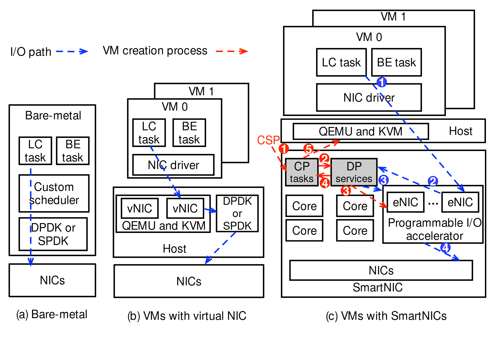

# VA-192 · 三种部署形态与双路径对照

三个并列面板从裸机、虚拟网卡到可编程网卡逐渐增加部署层次。蓝色虚线追踪 I/O 路径，红色虚线只在最右面板追踪设备创建控制过程，两套编号独立。复用价值在于对照同一任务如何跨越不同部署边界，而非简单罗列硬件。



## 适用范围

- 比较同一应用在三种部署方式中的路径差别
- 同时说明数据路径和配置控制路径的硬件卸载系统

不适合：只呈现一种系统且不需要对照；把部署层数直接当作性能高低的定量比较。

## 阅读顺序

1. 先读左上颜色图例，蓝为 I/O，红为虚拟机创建。
2. 由左到右比较三个部署面板，在每面板从任务层向下追踪 NIC。
3. 在最右面板沿蓝色编号看驱动、eNIC、DP 服务与物理网卡的关联。
4. 单独沿红色编号看 CSP、CP、DP 与主机虚拟化层之间的创建过程。
5. 最后对照虚拟机、主机、SmartNIC 三个不同边界，不跨面板混读。

## 图形表达

**布局**：三列宽度随复杂度递增，左列简短、中列有虚拟机叠卡、右列最多嵌套；物理 NIC 大致对齐在底部。

**对象**：矩形嵌套表示虚拟机、主机与设备边界；叠卡表示多个实例，重复小方框表示核与虚拟网卡。

**连线**：蓝红虚线各自有箭头与局部步骤编号；右侧线穿越多个边界，不能仅凭线交叉判断存在中间处理节点。

**配色**：主体黑白，蓝色专指 I/O 路径，红色专指创建过程；灰块区别 CP/DP 服务而非第三类流。

**文字**：普通无衬线标注组件，面板标题位于底部；右侧 eNIC、CP/DP 与小圈编号密集，需要更宽纸面版心。

## 部件与复用

| 部件 | 含义 | 改造方法 |
|---|---|---|
| 裸机部署 (`bare-metal`) | 任务经自定义调度和用户态 I/O 直接达到物理网卡。 | 替换应用与 I/O 框架时保持单机路径；不要人为加入虚拟层。 |
| 虚拟网卡部署 (`virtual-nic`) | 虚拟机驱动通过主机虚拟网卡与加速框架连接网卡。 | 按实际虚拟化栈调整驱动、vNIC 和主机模块。 |
| 可编程网卡部署 (`smartnic-deployment`) | 主机、虚拟机和智能设备分离，设备含核、CP/DP 与 I/O 加速器。 | 此面板宜整体移动；新增 eNIC 或核时重接两套路径。 |
| 双路径图例 (`path-legend`) | 将两种虚线颜色绑定到数据处理与创建控制。 | 改变业务语义需同步修改两种图例和各自编号。 |

## 改造步骤

1. 固定一个可比较的任务和统一的物理终点，再定义三种部署差别。
2. 逐面板重画数据路径，避免为了视觉对齐而编造中间跳转。
3. 把最右面板的控制路径与数据路径分别编号；允许两套同时从①开始但需颜色区分。
4. 减少或增加部署层时同时调整边界、图例和叠卡，不把当前框嵌套当固定模板。

## 新情景示例（假设）

假设场景：边缘视频推理的三种部署。

左为进程直连摄像头，中为容器网络转发，右为边缘加速卡处理；蓝线是视频数据，红线是流实例创建。

按真实接口重构右面板服务与设备核；新增性能结论需独立测量，不由层数推断。

## 编辑入口

**入口**：make_figure.py 为本图定制入口；example.json 配置一次生成；labels.json 定位文字；asset.json 保存部件及其元素成员。运行 python make_figure.py --config example.json --out . --parts。

**配置可改**：labels、components 可修改文字、配色、显隐与位移；它们不会根据新标签长度自动重排，也不会重算图中示意数值。

**需改代码**：拓扑、对象数量和跨部件连接在 customize(root, context) 中编辑。新增对象设 data-asset-key 并更新对应部件 element_keys；跨区域连线默认留在整图，移动部件后需重接；有重叠部件时避免重复位移同一元素。

**字体**：普通无衬线标注组件，面板标题位于底部；右侧 eNIC、CP/DP 与小圈编号密集，需要更宽纸面版心。 最终字体文件以构建映射为准；源坐标的局部 font_size 不等于论文纸面 pt，需按最终插图宽度复核。本批构建已确认并嵌入完整字体：texgyreheros-bold.otf, texgyreheros-regular.otf。映射可能改变原字形和字宽，需按实际论文尺寸复核。

准备独立工作副本：

```text
python "<SKILL>/scripts/prepare_architecture.py" --id VA-192 --out figures/architecture
```

在工作副本运行：

```text
python make_figure.py --config example.json --out . --parts
python render_architecture.py fig.svg
```

## 本图检查

- 三种部署是否针对同一业务终点。
- 红蓝编号是否各自连续，未合成一条全局顺序。
- 箭头是否穿过文字或误落到边界而不是模块。
- 缩小后右侧控制线与数据线是否仍可区分。

部件图用于复用局部对象；跨边界的连接和共享容器仍需按新关系处理。示例名称、数值和曲线不是当前研究结果。

来源与许可见 [ATTRIBUTION.md](ATTRIBUTION.md)。
