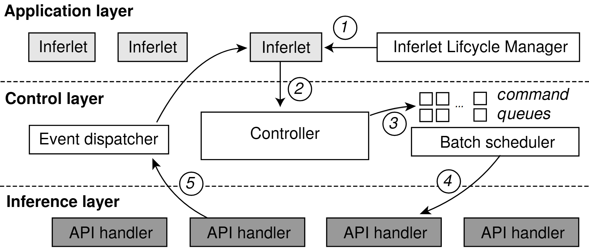

# VA-193 · 三层请求批处理与事件回送

应用、控制和推理三层用水平虚线分隔。请求先从生命周期管理器进入一个应用实例，再经过控制器、命令队列与批调度器下发到执行器；结果沿左侧弧线返回事件分发器并回到应用。少量灰阶与编号就能清楚表达跨层闭环。



## 适用范围

- 多应用请求归并成批执行，再异步回送结果的系统
- 应用生命周期管理与底层批处理分离的服务架构

不适合：每个请求同步直达唯一执行器的简单 RPC；需要准确批大小或执行时间的性能图。

## 阅读顺序

1. 读上层①：生命周期管理器向左控制某个应用实例。
2. 沿②下行到控制层的 Controller。
3. 沿③右行进入命令队列，再看队列下方批调度器。
4. 沿④到下层 API handler 执行。
5. 沿⑤返回左侧事件分发器，再沿无编号弧线回到应用，形成闭环。

## 图形表达

**布局**：三条水平带共享全幅；应用实例横向重复，控制层左分发、中控制、右队列调度，执行层为重复处理器。

**对象**：应用与处理器用简单矩形，小格队列表达待处理命令；黑边圆形编号分布在箭头旁。

**连线**：①从右向左，②向下，③向右，④向下偏左，⑤向上偏左；回送到应用的弧线没有新编号。

**配色**：灰阶区分应用实例与更深灰的底层处理器，控制功能白底；没有用颜色表达不同业务类别。

**文字**：层名粗体靠左，组件名普通无衬线，command queues 斜体分行；步骤数字为略斜的圆圈编号。

## 部件与复用

| 部件 | 含义 | 改造方法 |
|---|---|---|
| 应用实例与生命周期管理 (`application-control`) | 多应用共享一个生命周期管理入口，选中实例接收①。 | 增减应用实例时重接①和事件返回端点。 |
| 请求控制器 (`request-controller`) | 负责把应用调用变为队列命令。 | 替换控制功能并保持②入口与③出口分离。 |
| 命令队列与批调度器 (`queue-batcher`) | 小格命令积累后交给调度器形成批次。 | 修改队列类别和批策略时重建小格及标签，不把格数当已计算批大小。 |
| 事件分发器 (`event-dispatcher`) | 接收底层结果并把事件送回应用。 | 若改成同步响应应重新设计回送路径。 |
| 并排执行处理器 (`execution-handlers`) | 重复 API 处理器承担批执行。 | 复制或删减执行器后重新接④⑤；等宽矩形不表示算力完全相同。 |

## 改造步骤

1. 先定义请求生命周期与结果回送是同步还是异步。
2. 按真实业务修改五个编号步骤，生命周期控制不应被错误视为数据预处理。
3. 增减队列和执行器时更新分配关系，不只替换文字。
4. 用 customize 重新连接跨层弧线，保留水平边界和清晰的回路方向。

## 新情景示例（假设）

假设场景：多业务的批量路线求解服务。

上层实例为配送任务程序，Controller 为求解请求规范器，队列为不同约束类别，处理器为批量求解后端。

事件分发器返回求解结果或失败状态；若后端异构则调整处理器宽度或增加类别标注。

## 编辑入口

**入口**：make_figure.py 为本图定制入口；example.json 配置一次生成；labels.json 定位文字；asset.json 保存部件及其元素成员。运行 python make_figure.py --config example.json --out . --parts。

**配置可改**：labels、components 可修改文字、配色、显隐与位移；它们不会根据新标签长度自动重排，也不会重算图中示意数值。

**需改代码**：拓扑、对象数量和跨部件连接在 customize(root, context) 中编辑。新增对象设 data-asset-key 并更新对应部件 element_keys；跨区域连线默认留在整图，移动部件后需重接；有重叠部件时避免重复位移同一元素。

**字体**：层名粗体靠左，组件名普通无衬线，command queues 斜体分行；步骤数字为略斜的圆圈编号。 最终字体文件以构建映射为准；源坐标的局部 font_size 不等于论文纸面 pt，需按最终插图宽度复核。本批构建已确认并嵌入完整字体：texgyreheros-bold.otf, texgyreheros-italic.otf, texgyreheros-regular.otf。映射可能改变原字形和字宽，需按实际论文尺寸复核。

准备独立工作副本：

```text
python "<SKILL>/scripts/prepare_architecture.py" --id VA-193 --out figures/architecture
```

在工作副本运行：

```text
python make_figure.py --config example.json --out . --parts
python render_architecture.py fig.svg
```

## 本图检查

- ①方向是否仍为管理器指向应用。
- ⑤是否接回事件分发器，再返回应用而不是直接结束。
- 队列小格是否只是结构示意，未虚称批大小。
- 两条层界线是否穿越长文本或步骤圈。

部件图用于复用局部对象；跨边界的连接和共享容器仍需按新关系处理。示例名称、数值和曲线不是当前研究结果。

来源与许可见 [ATTRIBUTION.md](ATTRIBUTION.md)。
