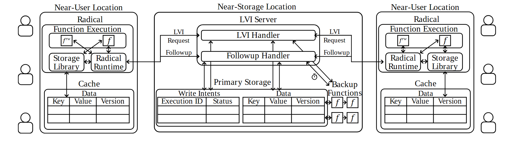

# VA-030 · 双边缘执行与中央状态协调

两侧近用户执行区围绕中央存储协调区展开。边缘区内部含函数执行、运行时和缓存，中央区把请求处理、后续处理、状态表及备用动作分层放置。左右相似布局说明同类站点共享中央服务，底部表格让读者看到保存的信息，而非只有抽象数据库图标。



## 适用范围

- 多边缘站点共享中央状态
- 需要解释初始请求与后续确认的协调协议

不适合：纯无状态请求转发；大量站点之间的任意网状通信。

## 阅读顺序

1. 从一侧用户图标进入边缘执行区
2. 辨认运行时与缓存交互，再追踪跨站请求
3. 在中央区区分初始处理与后续处理
4. 向下看意图表、数据表和备用动作，最后用右侧验证多站点对称性

## 图形表达

**布局**：横向三栏，中央较宽，两侧近似镜像；表格位于各站点下部，防止跨站线穿越字段。

**对象**：圆角框逐层包含运行环境和功能，小表格显示键、值、版本等结构，人形标记服务使用者。

**连线**：细黑箭头统一表达通信，方向和邻近文字区分请求与回访；时钟小图形提示超时触发路径。

**配色**：主要采用黑白轮廓，没有用颜色区分协议消息，区分责任依赖分组标题和位置。

**文字**：衬线正文与斜体函数符号形成技术说明感；三栏内容密集，优先保持最终版面的可读字号。

## 部件与复用

| 部件 | 含义 | 改造方法 |
|---|---|---|
| 边缘执行站点一 (`left-edge`) | 集成本地函数、运行时和缓存的近端站点。 | 可改为门店或边缘设备；缓存字段必须对应真实数据模型。 |
| 中央请求处理组 (`validation-handlers`) | 先处理进入请求，再处理后续结果的两个职责条。 | 若新协议只有一阶段，应合并处理条并删除无效回访线。 |
| 中央状态记录组 (`central-storage`) | 保存未完成执行状态、业务数据及备用动作。 | 重写字段；备用动作仅在确有超时补偿机制时保留。 |
| 边缘执行站点二 (`right-edge`) | 展示另一个共享中央协调的同类站点。 | 异构站点应调整内部模块，不只是换站点名称。 |

## 改造步骤

1. 先明确谁拥有权威数据，谁保存缓存副本
2. 逐条标注初始请求、后续通知和超时补偿的真实含义
3. 保持左右站点数据字段一致，除非异构就是要解释的重点
4. 增加第三类站点或更多表字段时重排三栏比例，不直接压缩字体

## 新情景示例（假设）

可用于多门店库存预占系统的设计图。

边缘区对应门店收银与库存缓存，中央处理组对应预占申请及确认，状态表记录订单与预占状态。

根据真实协议增设取消或超时释放路径；将备用函数图标改为补偿动作，不宣称具备未经实现的一致性保证。

## 编辑入口

**入口**：make_figure.py 读取 example.json；labels.json 查文字键，asset.json 查部件键；输出 SVG，可用配套渲染脚本导出 PDF。

**配置可改**：labels 修改文字及字体属性；components 可设 visible、dx/dy、attributes；elements 修改单个对象属性。平移使用图的坐标单位，重叠部件不要同时平移。

**需改代码**：改变模块数量、连接关系或分栏布局须编辑 customize()，不会自动布线。新对象需唯一 data-asset-key，并加入对应部件 element_keys，才会随部件导出。

**字体**：本图映射字体：Tinos-Italic.ttf, Tinos-Regular.ttf。沿用完整字体覆盖新字符；font_size 是元素局部单位，不是纸面 pt。改长标签后检查字宽、裁切及最终 PDF。

准备独立工作副本：

```text
python "<SKILL>/scripts/prepare_architecture.py" --id VA-030 --out figures/architecture
```

在工作副本运行：

```text
python make_figure.py --config example.json --out . --parts
python render_architecture.py fig.svg
```

## 本图检查

- 本地缓存与中央权威数据是否区分明确
- 后续处理的返回线有没有误接到初始入口
- 超时图标和备用动作是否有真实触发条件

部件图用于复用局部对象；跨边界的连接和共享容器仍需按新关系处理。示例名称、数值和曲线不是当前研究结果。

来源与许可见 [ATTRIBUTION.md](ATTRIBUTION.md)。
