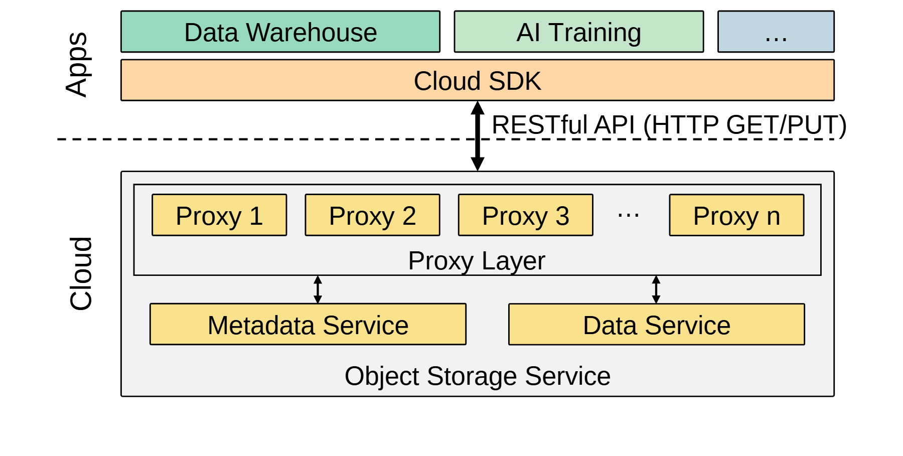

# VA-194 · 共享接口与对象存储服务分层

应用区的多个业务先汇入一条共享 SDK，再通过双向接口跨入云服务。云内代理池作为中间横带，向下分别连接元数据和数据服务。图用短标签、嵌套框和同色服务块建立访问边界，适合解释客户端能接触到哪一层。



## 适用范围

- 多个应用共享统一 API 访问后台资源
- 代理层将元数据与实体数据服务隔离的系统概览

不适合：强调节点容错、复制数量或一致性协议；需要详细认证授权链路的安全机制图。

## 阅读顺序

1. 从上排业务方块读到覆盖全宽的 Cloud SDK。
2. 顺双向箭头跨过虚线 Apps/Cloud 边界，并读 API 文本。
3. 进入云内 Proxy Layer，识别多个代理实例和省略号。
4. 沿两个短双向箭头分别到元数据服务与数据服务。
5. 最后用外围 Object Storage Service 框确认这三层都属于同一云端服务。

## 图形表达

**布局**：顶部业务横排和 SDK 总条位于边界上方；下方云服务大框内是宽代理池和两块并列后端。

**对象**：矩形和嵌套矩形表示应用及服务；代理实例以等高卡片加省略号表达可扩展集合。

**连线**：SDK 与代理之间是跨边界的双向竖箭头；后端各有独立双向连接，图没有画元数据与数据服务之间的横向关系。

**配色**：应用用绿与淡蓝区分示例业务，SDK 浅橙，云服务浅灰，代理及后端黄色；颜色不编码性能指标。

**文字**：Apps 与 Cloud 旋转竖排作为域名；服务名无衬线，API 长标签靠边界右侧，修改后容易越界。

## 部件与复用

| 部件 | 含义 | 改造方法 |
|---|---|---|
| 应用与统一接口 (`application-sdk`) | 多个应用共享同一个 SDK 入口。 | 增删业务卡片并调整 SDK 宽度，避免暗示每个应用各有独立 SDK。 |
| 跨域接口 (`api-boundary`) | 双向 API 跨越应用/云边界。 | 明确实际协议与调用能力；长标签换行或留在图右侧。 |
| 代理实例池 (`proxy-pool`) | 多个代理作为统一中介服务。 | 按实例类型修改卡片与省略号，数量只作示意时不要宣称部署规模。 |
| 元数据服务 (`metadata-service`) | 命名与位置等元信息独立管理。 | 换成目录、索引或控制服务时同步更改职责说明。 |
| 实体数据服务 (`data-service`) | 负责实际数据存取，与元数据职责分开。 | 按实际后端替换名称；不要凭空补上未实现的横向同步边。 |

## 改造步骤

1. 将业务、SDK、代理和两个后端映射到新系统实际访问层。
2. 确认跨域 API 能力，示例 HTTP GET/PUT 不应自动沿用于其他协议。
3. 按后端职责改名后重新审查代理分别连接哪一侧。
4. 如果新增缓存或认证层，应在 customize 中新增实体与边，不用改字把两个职责塞进一个框。

## 新情景示例（假设）

假设场景：城市公共数据目录平台。

上排为交通分析和规划应用，SDK 为开放接口，代理为请求路由，后端分别是元数据目录与文件对象存储。

增加认证模块时在 API 边界旁创建独立节点，并由实际接入方式决定连线。

## 编辑入口

**入口**：make_figure.py 为本图定制入口；example.json 配置一次生成；labels.json 定位文字；asset.json 保存部件及其元素成员。运行 python make_figure.py --config example.json --out . --parts。

**配置可改**：labels、components 可修改文字、配色、显隐与位移；它们不会根据新标签长度自动重排，也不会重算图中示意数值。

**需改代码**：拓扑、对象数量和跨部件连接在 customize(root, context) 中编辑。新增对象设 data-asset-key 并更新对应部件 element_keys；跨区域连线默认留在整图，移动部件后需重接；有重叠部件时避免重复位移同一元素。

**字体**：Apps 与 Cloud 旋转竖排作为域名；服务名无衬线，API 长标签靠边界右侧，修改后容易越界。 最终字体文件以构建映射为准；源坐标的局部 font_size 不等于论文纸面 pt，需按最终插图宽度复核。本批构建已确认并嵌入完整字体：Arimo-Regular.ttf。映射可能改变原字形和字宽，需按实际论文尺寸复核。

准备独立工作副本：

```text
python "<SKILL>/scripts/prepare_architecture.py" --id VA-194 --out figures/architecture
```

在工作副本运行：

```text
python make_figure.py --config example.json --out . --parts
python render_architecture.py fig.svg
```

## 本图检查

- API 是否确实跨越 Apps/Cloud 分界。
- 两种后端是否职责明确，未把元数据当数据副本。
- 代理卡片数量与省略号是否只是示意。
- 旋转域名、长 API 标签及双向箭头是否可读。

部件图用于复用局部对象；跨边界的连接和共享容器仍需按新关系处理。示例名称、数值和曲线不是当前研究结果。

来源与许可见 [ATTRIBUTION.md](ATTRIBUTION.md)。
