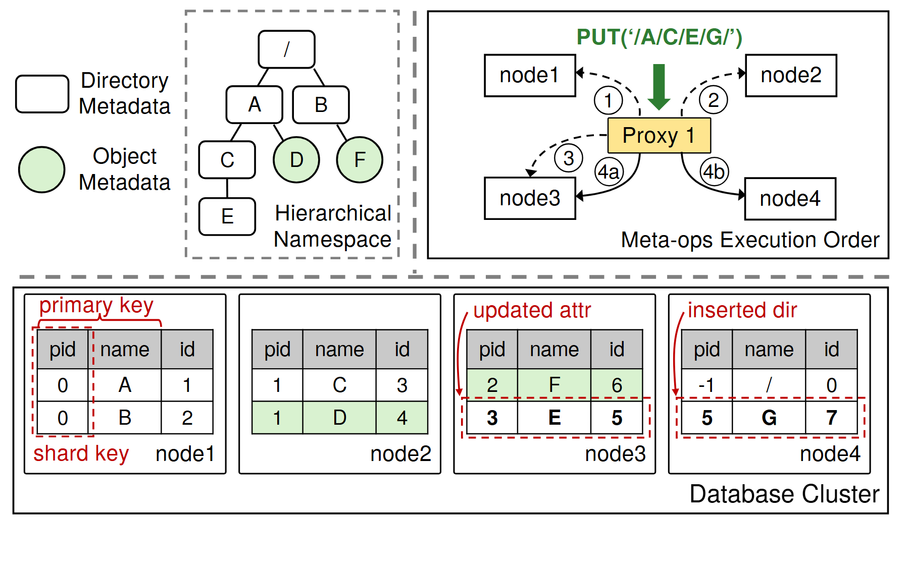

# VA-069 · 层次对象到分片表的操作映射

左上以树表示对象层次，右上以代理和编号箭头表示访问顺序，下半部用四张小表解释数据落在哪些节点以及哪些行发生变化。读者能把逻辑路径、执行过程和物理记录三种视角对照起来。表内数字是示例关系，迁移时需要成套改写。



## 适用范围

- 树形对象映射到多节点表结构
- 一次操作包含查找及跨节点更新

不适合：只有树结构不涉及存储映射；数据表很大需要逐行完整展示。

## 阅读顺序

1. 先读左侧图例，区分目录矩形与对象圆形。
2. 沿树定位操作涉及的路径。
3. 查看右上代理依次访问哪些节点及分叉更新。
4. 到下方表中核对键列、父子关系和红色变更区域。

## 图形表达

**布局**：上方两面板并排，下方通栏放四个数据库节点；虚线分隔逻辑视角与记录视角。

**对象**：圆和圆角矩形区分对象类型，表格提供键值对应，红色虚框圈出主键和被修改行。

**连线**：树边表示父子关系；代理周围带号码的箭头表示访问次序，末端 a/b 表示操作分支。

**配色**：绿色圆形及绿色表行对应对象记录，黄色代理强调协调入口，红色用于键定义和变更注释。

**文字**：小表使用整齐的无衬线短字段，变更后的字可加粗；长字段应扩列而非覆盖边界。

## 部件与复用

| 部件 | 含义 | 改造方法 |
|---|---|---|
| 类型图例 (`object-legend`) | 两种形状代表不同对象类别。 | 与树节点和表中对应行一起改。 |
| 层次对象 (`hierarchical-objects`) | 对象由父子边构成命名或归属路径。 | 更换路径时重接树边。 |
| 访问代理 (`proxy-order`) | 一次请求触发多轮节点访问及更新。 | 按新操作重编号，分支不强作顺序。 |
| 分片记录 (`sharded-tables`) | 节点表展示键映射和修改位置。 | 同时改父键、对象编号、行位置及变更标记。 |

## 改造步骤

1. 建立一份树节点到表记录的对应表再改图。
2. 区分查找读操作和真正写入操作。
3. 所有示例值应构成一致的小例，不作为测量结果。

## 新情景示例（假设）

可用于组织目录新增部门的分布式存储说明。

树映射为机构层级，代理映射为目录服务，四张表映射为分区数据库，红框标出父节点更新和新行插入。

删掉文件操作符号，按真实分区键重新分配记录并重排访问步骤。

## 编辑入口

**入口**：运行 make_figure.py；example.json 为配置，labels.json 查文字键，asset.json 查部件。使用 --parts 导出独立矢量部件。

**配置可改**：labels 可改文字及字体；components 可设置 visible、dx/dy、attributes；elements 可按键改图元属性。移动量使用整图 viewBox 单位，重叠部件只选一个层级移动。

**需改代码**：增删节点、调整连接和重排结构须在 customize() 中处理；新增图元使用唯一 data-asset-key，并登记至相应部件 element_keys。配置不会自动排版。

**字体**：本图使用 texgyreheros-bold.otf、texgyreheros-regular.otf。font_size 是图元局部坐标单位，受既有缩放影响，不等于纸面 pt；改字后检查实际字宽与最终阅读尺寸。

准备独立工作副本：

```text
python "<SKILL>/scripts/prepare_architecture.py" --id VA-069 --out figures/architecture
```

在工作副本运行：

```text
python make_figure.py --config example.json --out . --parts
python render_architecture.py fig.svg
```

## 本图检查

- 树中每个编号是否能在对应表记录中解释。
- 主键与分片键的红框是否圈住正确列。
- 更新及插入标记是否和末端访问分支一致。

部件图用于复用局部对象；跨边界的连接和共享容器仍需按新关系处理。示例名称、数值和曲线不是当前研究结果。

来源与许可见 [ATTRIBUTION.md](ATTRIBUTION.md)。
