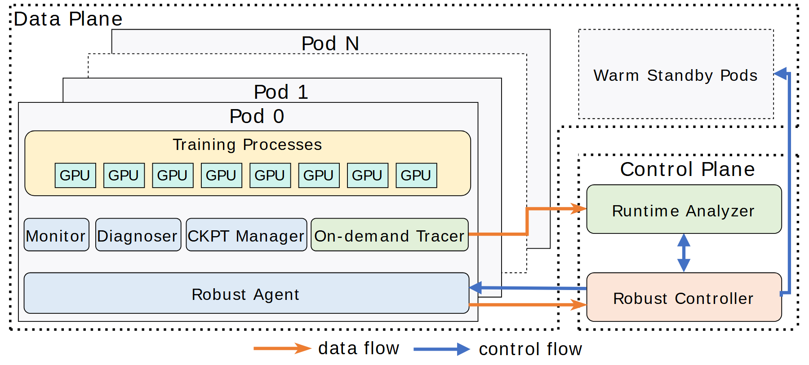

# VA-032 · 观测诊断驱动的备用资源恢复图

用左侧重复执行单元与右侧控制区解释故障恢复的职责分工。执行侧包含业务负载、观测工具及本地代理，控制侧负责分析和动作协调，备用池提供可替换资源。橙色路径传递诊断信息，蓝色路径下发控制，二者不应合并为一条含糊的反馈箭头。



## 适用范围

- 有观测、诊断、恢复执行和备用资源的系统
- 需要解释多实例业务的故障处理边界

不适合：没有自动恢复动作的单纯监控仪表盘；没有备用能力却想展示热切换效果。

## 阅读顺序

1. 查看左侧叠放容器及内部业务资源
2. 读取中间观测工具排和底部本地代理
3. 沿橙色信息路径进入右侧分析器
4. 沿蓝色控制路径返回代理并查看备用资源调度

## 图形表达

**布局**：左侧占约三分之二宽度，后移的容器暗示多个同构实例；右侧上为备用池，下为分析与控制。

**对象**：业务资源用重复小格，观测工具横排，执行代理用贯通底条；虚线外框区分控制边界。

**连线**：橙色单向箭头表示观测数据输出，蓝色箭头表示控制与协调；返向路径走底边减少遮挡。

**配色**：浅黄承载业务，浅蓝承载代理与工具，浅绿和浅橙区分分析器、控制器；颜色只区分类别，不表示健康等级。

**文字**：使用无衬线字体，工具名称宜短，避免四个窄框塞入长句；堆叠容器标题保持同字号。

## 部件与复用

| 部件 | 含义 | 改造方法 |
|---|---|---|
| 运行实例组 (`runtime-pods`) | 同构容器内运行多个工作进程及资源。 | 替换实际实例和资源名称，省略数量时注明代表性展示。 |
| 观测诊断工具 (`diagnostic-suite`) | 监测、诊断、检查点和追踪各承担不同职责。 | 删去没有实现的观测能力，不为了保持四格而编造功能。 |
| 本地恢复代理 (`local-agent`) | 接收控制并落实重启或切换等动作。 | 明确可执行动作及作用范围，不能将分析结论直接写成动作。 |
| 分析控制组合 (`control-pair`) | 分析器产出诊断，控制器协调处理。 | 写清两者的信息交换及谁拥有最终动作权。 |
| 备用池 (`standby-pool`) | 恢复时可申请的待用实例。 | 标明热备、冷备或假设资源，容量必须有依据。 |

## 改造步骤

1. 先区分观测数据、诊断结果和控制动作，再给路径命名
2. 检查点与追踪不是等价模块，替换时保持职责独立
3. 没有备用池就删除右上区及对应控制线
4. 移动本地代理前检查它是否同时包含在运行实例部件中

## 新情景示例（假设）

可用于假设的分布式水质监测服务恢复方案。

运行单元为采集站服务，观测排为心跳、数据校验、状态快照与日志，备用池为备用计算节点。

将业务资源小格改为采集任务，恢复代理只执行任务迁移；若传感器无法远程替换，不画传感器热备。

## 编辑入口

**入口**：make_figure.py 读取 example.json 生成 fig.svg；加 --parts 导出部件，render_architecture.py 渲染预览及 PDF。

**配置可改**：labels 按 labels.json 对象键改字；components 支持 visible、dx/dy、attributes；elements 改对象属性。位移用图内坐标，连线不自动重布。

**需改代码**：增删模块、改连接和布局须修改 customize()。新对象须有唯一 data-asset-key 并登记部件归属；嵌套部件选一个层级平移，避免重复移动。

**字体**：当前完整字体为 Arimo-Regular。font_size 是元素局部坐标单位，受缩放变换影响，不是纸面字号；改长标签后按最终版面宽度复核换行与字距。

准备独立工作副本：

```text
python "<SKILL>/scripts/prepare_architecture.py" --id VA-032 --out figures/architecture
```

在工作副本运行：

```text
python make_figure.py --config example.json --out . --parts
python render_architecture.py fig.svg
```

## 本图检查

- 信息上报与动作下发是否仍由不同线色表达
- 备用池是否存在明确的申请与接管关系
- 本地代理移动后容器边界及底部回线是否错位

部件图用于复用局部对象；跨边界的连接和共享容器仍需按新关系处理。示例名称、数值和曲线不是当前研究结果。

来源与许可见 [ATTRIBUTION.md](ATTRIBUTION.md)。
