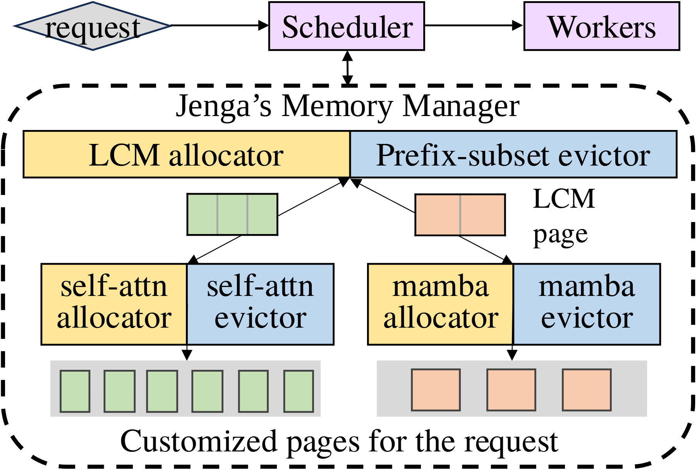

# VA-195 · 共享页管理与双类型分配器

上方调度器与工作器形成请求主线，下方虚线管理器内部先用共享分配/回收对管理页面，再由左右两类专用分配/回收对细化页面。黄色与蓝色始终分别表示分配和回收，绿色与桃色则区分两类页面，两个颜色维度不可混为一谈。



## 适用范围

- 共享资源单位再由不同类别专门细分的两级管理
- 分配与回收在通用层和类型层都分别存在的系统

不适合：只有一种对象且不需要分层管理；把所有箭头都当自上而下数据流的普通流水线。

## 阅读顺序

1. 先读顶部 request→Scheduler→Workers，调度器与管理器间是上下双向联系。
2. 进入虚线框，读第一层黄色分配器和蓝色回收器。
3. 观察中部绿色、桃色页面以及它们连回共享层的箭头。
4. 分别沿下行边进入两组专用分配器/回收器。
5. 读底部不同大小的页面集合，理解同一请求得到不同类型定制页。

## 图形表达

**布局**：顶部业务主线占窄横带，管理器占下方大圆角虚线框；内部通用层横跨左右，两类专用层并列。

**对象**：分配器和回收器为相邻色块，页用分段矩形表示，中部页大、底部页集合小；虚线外框是管理责任域。

**连线**：请求主线向右，调度器与管理器双向；页到共享层可见上行箭头，页到专用层和定制页为下行连接，不全是单向分配链。

**配色**：黄色始终标分配器，蓝色始终标回收器；绿色页面对应左类，桃色页面对应右类，底部灰底只作为集合承托。

**文字**：图中管理器名称与部分文字呈衬线角色，其余可因字体映射显示为无衬线；两行 allocator/evictor 标签需与页面标注留距。

## 部件与复用

| 部件 | 含义 | 改造方法 |
|---|---|---|
| 请求调度主线 (`request-line`) | 上层请求先交调度器，再到工作器，并调用下方管理器。 | 按真实服务替换请求、调度、执行角色并重接上下连接。 |
| 通用分配与回收层 (`shared-managers`) | 共享页面管理由分配和回收两个责任块组成。 | 改变页管理算法时替换两个名称，不能只改一个统称。 |
| 两类共享页对象 (`shared-pages`) | 中部两种页面建立共享层与类型专用层之间的接口。 | 按实际单位重画页内分段，颜色贯穿底部结果。 |
| 左类专用分配回收 (`left-specialization`) | 第一类资源有自己成对的分配/回收策略。 | 新增策略时保持分配与回收相邻但职责不同。 |
| 右类专用分配回收 (`right-specialization`) | 第二类资源用同构管理接口承载不同策略。 | 按真实类型替换而不是复制左类算法结论。 |
| 定制页面集合 (`page-outputs`) | 两类不同尺寸页面合为本次请求的资源输出。 | 用实际页大小与数量重画，灰色底板不作为定量坐标轴。 |

## 改造步骤

1. 先确认共享单位以及各类型细分单位，当前 LCM 只是示例算法。
2. 分别改写通用层和专用层的分配与回收职责。
3. 同步修改页面颜色、格数和输出大小；黄色/蓝色表示操作角色，不能被类型颜色替代。
4. 新增第三种资源时扩展管理器宽度、增加第三分支并重画中部上行和下行连接。

## 新情景示例（假设）

假设场景：多规格仓储货位分配。

共享页面变成标准货位组，两类专用分配器为整托与拆零规则，回收器负责释放货位。

按货位实际容量调整分段与底部小格；若没有 LCM 约束则删除该算法名并说明新的共享单位。

## 编辑入口

**入口**：make_figure.py 为本图定制入口；example.json 配置一次生成；labels.json 定位文字；asset.json 保存部件及其元素成员。运行 python make_figure.py --config example.json --out . --parts。

**配置可改**：labels、components 可修改文字、配色、显隐与位移；它们不会根据新标签长度自动重排，也不会重算图中示意数值。

**需改代码**：拓扑、对象数量和跨部件连接在 customize(root, context) 中编辑。新增对象设 data-asset-key 并更新对应部件 element_keys；跨区域连线默认留在整图，移动部件后需重接；有重叠部件时避免重复位移同一元素。

**字体**：图中管理器名称与部分文字呈衬线角色，其余可因字体映射显示为无衬线；两行 allocator/evictor 标签需与页面标注留距。 最终字体文件以构建映射为准；源坐标的局部 font_size 不等于论文纸面 pt，需按最终插图宽度复核。本批构建已确认并嵌入完整字体：Tinos-Regular.ttf, texgyretermes-regular.otf。映射可能改变原字形和字宽，需按实际论文尺寸复核。

准备独立工作副本：

```text
python "<SKILL>/scripts/prepare_architecture.py" --id VA-195 --out figures/architecture
```

在工作副本运行：

```text
python make_figure.py --config example.json --out . --parts
python render_architecture.py fig.svg
```

## 本图检查

- 黄色分配与蓝色回收是否在两级中一致。
- 绿色与桃色是否只区分页面类型。
- 中部连回共享层的上行箭头是否保留而非误画为下行。
- 页的格数、大小与文本单位是否一致，是否误作实验结果。

部件图用于复用局部对象；跨边界的连接和共享容器仍需按新关系处理。示例名称、数值和曲线不是当前研究结果。

来源与许可见 [ATTRIBUTION.md](ATTRIBUTION.md)。
