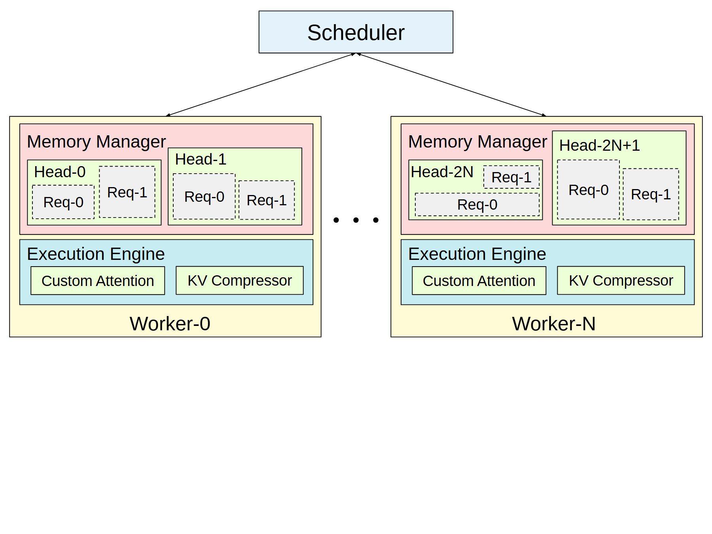

# VA-033 · 集中派发与重复工作单元的内部层级

一个公共调度器向多个同构工作单元派发任务，每个单元都展开为上方管理层和下方执行层。管理层继续按资源组划分请求槽，执行层并排放两个功能模块。首末两个单元与中间省略号表达可扩展部署；重点是重复单元内部的组织，不应把嵌套框误读成串行处理流水线。



## 适用范围

- 同构工作者的资源管理与执行协作
- 需要展示每个实例内部相同组织结构的并行系统

不适合：每个节点职责完全不同的异构网络；需要描述严格时间先后的复杂执行流程。

## 阅读顺序

1. 先从顶部调度器追踪分发到两个代表工作单元。
2. 读取工作单元内管理层的两组资源及组内请求槽。
3. 再读下方执行层的并列功能，最后用省略号理解中间同构实例。

## 图形表达

**布局**：顶端一个窄调度框，下方两个等宽单元并排；内部上下分层，避免额外外框扩大留白。

**对象**：黄色外壳包含粉色管理层与青色执行层；资源组为浅绿实框，请求槽用灰色虚框区别动态分配。

**连线**：仅顶部派发线是跨单元流向；内部没有箭头的包含关系不能自动解释成数据流。

**配色**：颜色按职责层级分配，并在所有工作单元保持一致；浅绿跨两层使用时仍需标签说明具体类型。

**文字**：工作者名称和子系统名大于请求编号；索引采用简短符号，勿让长组名挤占小槽。

## 部件与复用

| 部件 | 含义 | 改造方法 |
|---|---|---|
| 集中调度器 (`scheduler`) | 面向所有工作单元分发待处理任务 | 写明分发对象，若实际是广播或分片需在连线旁说明。 |
| 首工作单元 (`worker-zero`) | 完整展示一个重复实例的两层职责 | 新增实例时复用同样的内部排列，避免一边多出无解释模块。 |
| 组内请求槽 (`resource-groups`) | 管理层按组管理多个请求份额 | 把组和请求两级命名分开；虚线表示动态槽时不再用它表示边界不确定。 |
| 本地执行层 (`execution-engine`) | 两个并列执行功能共享工作单元 | 若两功能存在先后或反馈，应新增真实连线，而不是默认上下继承。 |
| 末工作单元 (`worker-final`) | 代表索引末端的同构实例 | 索引应与首单元一致；N 是末索引还是总数要在正文明确。 |

## 改造步骤

1. 先判断工作单元是否同构，确定管理层的组与组内对象分别是什么。
2. 保留一个完整实例并决定第二个是末实例还是另一类实例，后者不应再用省略号暗示同构。
3. 将功能模块改为真实职责，补充必要内部流向，删除无意义请求槽。
4. 统一层级配色和编号，对比两端实例是否存在无意结构差异。

## 新情景示例（假设）

假设设计城市仿真任务的并行执行平台。

调度器分派场景批次，工作者运行仿真实例；管理层按场景类别管理任务槽，下层包含状态推进与结果压缩。

将请求槽数量按实际示意调整；如果结果压缩只在运行结束后发生，应补从状态推进到结果压缩的有向边。

## 编辑入口

**入口**：在工作副本修改 example.json，运行 python make_figure.py --config example.json --out output --parts；再通过 Vivid 的矢量渲染入口检查 SVG 与 PDF。

**配置可改**：labels 按 labels.json 的元素键改字；components 按本页部件 id 设置 visible、dx、dy 或 attributes；elements 修改指定矢量元素属性。重叠部件可能共享元素，避免对父区域和内部区域重复位移。

**需改代码**：实例数、管理分组或请求槽数量需改写对应矢量对象和边界；内部依赖新增时显式绘制箭头。这些接口不会自动重排，也不会随部件移动自动修复跨部件连线。

**字体**：本资产已记录的完整字形资源：Arimo-Regular.ttf。修改英文标签优先沿用对应字体族与字重；文字变长时调整框宽和换行，不靠整体缩小压入。其他语言须另选覆盖所需字符的字体并实查导出。

准备独立工作副本：

```text
python "<SKILL>/scripts/prepare_architecture.py" --id VA-033 --out figures/architecture
```

在工作副本运行：

```text
python make_figure.py --config example.json --out . --parts
python render_architecture.py fig.svg
```

## 本图检查

- 省略号两侧是否确为同一类单元，索引含义一致？
- 组与请求槽的两层包含有没有被误写成任务先后？
- 顶部线是否清楚落到工作单元边界，执行层字号是否过小？

部件图用于复用局部对象；跨边界的连接和共享容器仍需按新关系处理。示例名称、数值和曲线不是当前研究结果。

来源与许可见 [ATTRIBUTION.md](ATTRIBUTION.md)。
