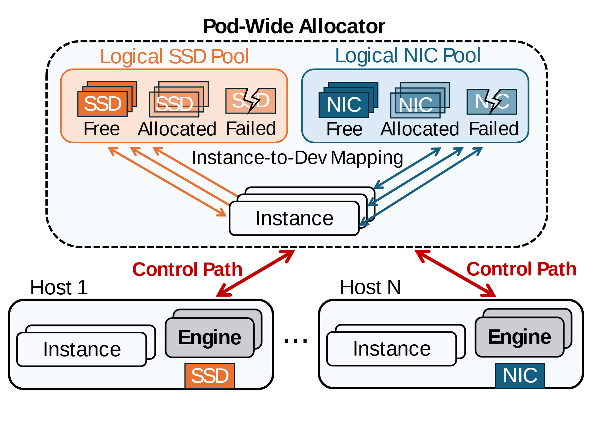

# VA-034 · 跨主机资源池与实例映射

上半部从全局视角管理两类资源，下半部展示分散在多台主机的执行实体。每类资源池列出空闲、占用与故障三种状态，彩色映射线连接逻辑资源和实例，红色控制线连接管理边界与主机。



## 适用范围

- 两类资源联合分配
- 逻辑池与物理部署并存的调度

不适合：不涉及共享池的单机流程；资源状态需要连续数值刻度的结果图。

## 阅读顺序

1. 先看虚线框中的全局分配范围。
2. 分别读两类资源池的三种状态。
3. 沿映射线确定实例绑定的资源。
4. 下移到主机看实例、引擎与物理资源。

## 图形表达

**布局**：上部一个管理大框，下部两台代表主机；省略号表达更多主机。

**对象**：资源卡片用叠片表示集合，故障状态使用断裂符号；实例在两个层级重复出现。

**连线**：橙蓝细线分别表示两类资源映射，红色粗箭头表达控制，不表示数据搬运。

**配色**：橙色和蓝色固定对应两种资源，灰色淡化已占用项，红色集中给控制路径。

**文字**：池名有色，状态词在卡片下方；主机编号与实例名保持独立。

## 部件与复用

| 部件 | 含义 | 改造方法 |
|---|---|---|
| 全局管理区 (`allocator`) | 两类池和实例映射处于统一分配范围。 | 明确这是逻辑管理边界，非单台物理机。 |
| 资源池甲 (`orange-pool`) | 同类资源的空闲、占用与故障状态。 | 替换图标时保留状态定义和排列顺序。 |
| 资源池乙 (`blue-pool`) | 第二类资源沿用相同状态编码。 | 两池必须能用同一状态解释。 |
| 逻辑实例映射 (`instance-mapping`) | 每个实例绑定多类资源。 | 按真实约束删除不允许的多对多连线。 |
| 主机部署 (`host-pair`) | 实例调用引擎并访问所属物理资源。 | 改主机数量时同步修改资源归属。 |

## 改造步骤

1. 先判断两类资源是否能分别分配，不能凭画面假设独立。
2. 故障符号仅代表不可用状态，不代表自动恢复已经实现。
3. 逻辑实例与物理实例重名时增加小编号以便对应。

## 新情景示例（假设）

假设用于仓库机器人与充电位联合分配。

橙池表示机器人，蓝池表示充电位，实例表示作业任务，底部主机改为分区控制器。

把硬件卡片替换为机器人和充电图元，控制路径改成任务下发并重画位置归属。

## 编辑入口

**入口**：以 make_figure.py 为入口，先复制 example.json 作为当前情景配置；labels.json 定位标签，asset.json 定位部件。

**配置可改**：labels 可改文字和文字样式，components 可做显隐、平移和局部样式调整；elements 可定位矢量元素。配置只作用于已有几何，不会自动解决布局冲突。

**需改代码**：添加第三类资源、改变状态数量或调整跨主机映射需改矢量和连线；共享配置只处理已有对象。

**字体**：当前替换字体为 Arimo-Bold、Arimo-Regular。改字后检查字宽、基线及 PDF 字体嵌入；原图的逐字定位不保证能容纳更长名称。

准备独立工作副本：

```text
python "<SKILL>/scripts/prepare_architecture.py" --id VA-034 --out figures/architecture
```

在工作副本运行：

```text
python make_figure.py --config example.json --out . --parts
python render_architecture.py fig.svg
```

## 本图检查

- 两种资源的色彩在池、映射线和部署端一致。
- 故障资源没有仍被正常分配的映射。
- 红色控制路径没有被图注误写成业务数据流。

部件图用于复用局部对象；跨边界的连接和共享容器仍需按新关系处理。示例名称、数值和曲线不是当前研究结果。

来源与许可见 [ATTRIBUTION.md](ATTRIBUTION.md)。
