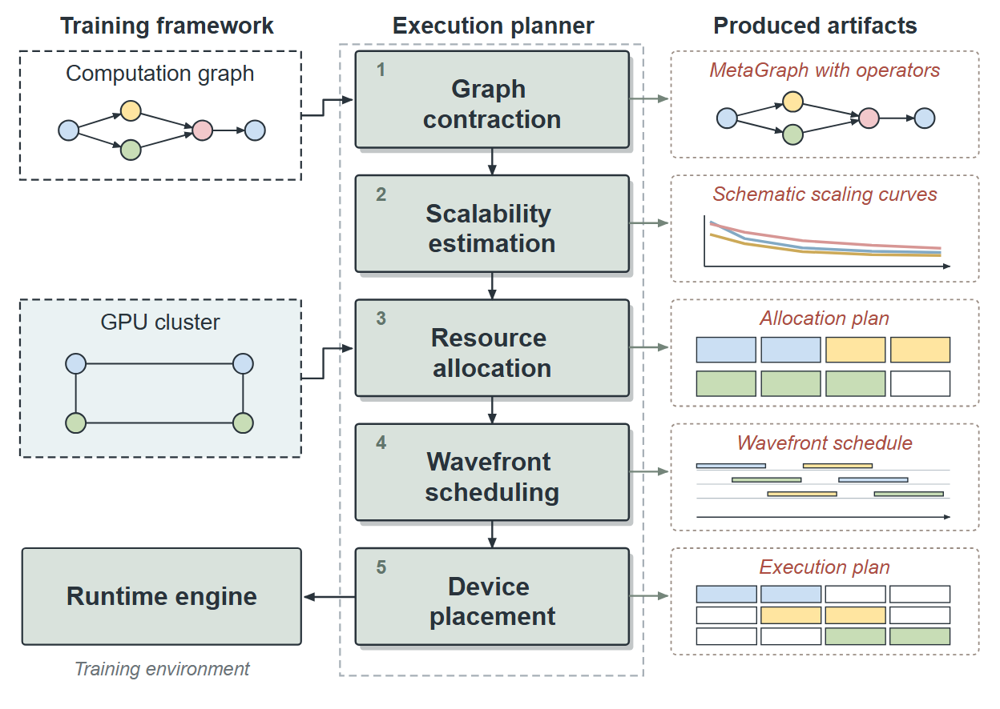

# VA-002 · 逐阶段推导与中间产物列（SVG 资产）

用输入、处理阶段、产物三列讲清方案如何形成。中列顺序推进，右列把每步抽象操作落实成图、曲线、分配表或时间表，末步回到左下执行端。它适合强调推导过程的总览，示意小图本身不构成计算证据。



## 适用范围

适合多步规划、调度方法及每步都有中间表示的算法。以并行分支为主或只有最终结果时，需重组构图以适应真实关系。

## 原图的视觉语言

原图以输入、步骤、产物三栏与短依赖箭头组织内容。浅灰阴影支持灰绿步骤卡；虚线小框容纳真实可编辑图、曲线、分配格、时间条与执行矩阵。暖红斜体区分产物标题。三栏是本例的构图起点，可根据新任务重组；字体尺度、线宽层级与对象表达应保持清楚。

## 部件与复用

| 部件 | 含义 | 编辑方法 |
|---|---|---|
| 阶段总区 (`planner`) | 限定顺序推导的整体边界。 | 阶段增减或分支变化时编辑 SVG 组、边界和依赖线；没有自动行数布局。 |
| 首阶段 (`stage-0`) | 接收初始问题并转换表示。 | 修改对应文本 key、阶段对象及右侧产物。 |
| 第二阶段 (`stage-1`) | 对前一步表示作分析。 | 如改成预测，右侧曲线必须随之替换。 |
| 第三阶段 (`stage-2`) | 形成资源或决策分配。 | 分配格颜色应与对象身份一致。 |
| 第四阶段 (`stage-3`) | 把决策转换为执行顺序。 | 时间条若是实算值需给定实际时间。 |
| 末阶段 (`stage-4`) | 生成可执行配置。 | 执行端连线始终跟随最后一个阶段。 |
| 图结构产物 (`artifact-0`) | 展示节点及依赖关系。 | 以实际节点和边替换示意图。 |
| 产物图节点 (`artifact-glyph-0`) | 产物框内的独立依赖图。 | 修改节点和边。 |
| 曲线产物 (`artifact-1`) | 展示趋势或函数近似。 | 保留示意标识或换成真实计算曲线。 |
| 趋势曲线 (`artifact-glyph-1`) | 产物框内的独立曲线对象。 | 替换原生曲线路径，保留示意说明或使用真实计算值。 |
| 分配格产物 (`artifact-2`) | 展示对象到资源的归属。 | 明确行列以及空格的含义。 |
| 分配单元格 (`artifact-glyph-2`) | 资源分配的内部格子。 | 编辑单元格对象、归属与颜色。 |
| 时间安排产物 (`artifact-3`) | 展示任务在时间轴上的占用。 | 重新定义起止时刻和泳道。 |
| 时间条 (`artifact-glyph-3`) | 排程框内的独立时间对象。 | 改任务时段与泳道。 |
| 执行矩阵产物 (`artifact-4`) | 展示最终放置关系。 | 矩阵维度须与资源数量吻合。 |
| 执行单元格 (`artifact-glyph-4`) | 执行矩阵的内部格子。 | 编辑单元格对象并同步行列定义。 |
| 问题输入 (`input-0`) | 提供初始结构。 | 编辑输入组内的原生图元与文字。 |
| 输入依赖图 (`input-glyph-0`) | 输入框中的具体节点关系。 | 编辑该组中的节点和依赖路径。 |
| 资源输入 (`input-1`) | 提供可用资源关系。 | 移动输入组，并同步调整其消费阶段的连接端点。 |
| 输入资源图 (`input-glyph-1`) | 资源框中的拓扑对象。 | 按真实连接替换节点和边。 |
| 执行端 (`runtime`) | 接收最终计划。 | 改为实际执行者或仿真器。 |

## 编辑入口

`diagram.svg` 保存全部原生图元、文本和嵌套组。`labels.json` 索引文字 key、字体、字号和部件；`geometry.json` 保存测量几何；`asset.json` 登记语义部件。原 Python 图形生成器不在本资产运行路径中。

`make_figure.py` 使用标准 `source_asset.run`。可直接编辑 `diagram.svg`，也可在 `customize(root, context)` 中重组已有对象，使用 `context['elements']`、`context['parts']` 和 `context['geometry']`。增加对象时设置唯一 `data-asset-key` 并登记部件成员；阶段数量变化须同步布局、边界与连接。

配置字段为 `labels`、`components` 和 `elements`；原代码的 `stages`、`inputs`、`artifact.kind` 不再是本资产的自动绘制接口。

## 字体与字号

画布为 900×638，默认宽度 468pt。原图使用系统 **Arial, sans-serif**：栏标题 21、阶段与执行端 23（粗体）；输入标题 20；产物标题 18（斜体）；序号和说明 17 viewBox 单位。对应常见纸面字号为 10.92、11.96、10.4、9.36、8.84pt；图内小标签见 `labels.json`。保留原字体、字重和斜体语义，调整内容时优先重排、换行与适配局部宽度。

标签替换显式选择源字体：

```json
{"labels":{"e0002":{"text":"New column title","font_family":"Arial"}}}
```

通用运行库未指定字体的标签替换可能使用 Arimo 回退；指定 `font_family` 可以保持源字体。多行标签宜在 SVG 中编辑各 `tspan` 及行距，通用标签替换会合并原多行文本。Arial 未随资产分发，渲染环境需安装其常规、粗体、斜体字形。标准准备流程会复制共享备用字体及许可；它们不改变默认源图。

## 运行与检查

从已注册此资产的 Skill 准备独立工作副本后执行：

```text
python make_figure.py --config example.json --out . --parts
python render_architecture.py fig.svg
```

检查每阶段都有语义匹配的产物，输入接入正确步骤，最终步骤指向实际执行者。阶段改动后更新部件范围、输出图和连接；以最终展示宽度审图。示例曲线、格子与名称不代表当前研究结果。

来源与许可见 [ATTRIBUTION.md](ATTRIBUTION.md)。
