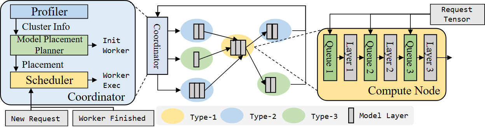

# VA-001 · 控制逻辑、异构网络与节点放大

紧凑横向构图同时解释三个尺度：左边展开控制器的观测、规划和调度；中间用不加大外框的网络展示多类对象；右边放大其中一个对象的等待与处理结构。底部事件入口和图例共用低矮横带。其价值在于跨尺度身份保持和不同层级的不同表达，不能为了复用而给新情景强加三段处理或模型层。



## 适用范围

- 集中控制连接异构对象且需要局部解释的系统
- 需要同时区分全局配置、逐任务调度和节点内部执行的总览

不适合：没有网络关系的单线业务流程；每个节点内部完全不同且都必须展开的复杂拓扑。

## 阅读顺序

1. 先看左侧观测到规划再到调度，区分配置与逐任务动作。
2. 沿控制器对应虚线认出中部小控制入口，再跟踪它与彩色节点的连接。
3. 沿选中节点的放大引线读右侧内部等待区与处理级。
4. 回到底部核对调度事件和节点类型图例。

## 图形表达

**布局**：横向三区分别承载控制逻辑、自由网络和局部机制；底栏只放短事件与图例，避免新增大标题挤占空间。

**对象**：彩色椭圆代表对象类型，内部灰竖条代表对象承载的处理单元；右侧细长等待框与处理条有真实角色，不能当装饰复制。

**连线**：控制逻辑用有向边，放大对应使用虚线；网络边须按当前情景区分物理连接、示例执行路径和返回路径。

**配色**：浅黄、浅蓝、浅绿标识三类对象，选中节点和展开背景保持同色；灰条单独由图例定义。

**文字**：主体采用衬线、短事件和部分小标签采用等宽字，细条内文字可竖排。长标签先简写或调整局部宽度，不整体缩小含文字的组合。

## 部件与复用

| 部件 | 含义 | 改造方法 |
|---|---|---|
| 控制逻辑展开 (`controller`) | 观测、规划、调度的内部组织 | 三项职责可重排，初始化与逐任务动作分别说明。 |
| 状态观测 (`profiler`) | 为规划提供对象状态 | 替换成实际测量或估计，不默认数据已经获得。 |
| 配置规划 (`planner`) | 生成对象部署或配置方案 | 说明离线或低频更新，避免与逐请求调度合并。 |
| 任务调度 (`scheduler`) | 在既定配置上处理到达与完成事件 | 按实际事件更新依赖，必要时增加异常出口。 |
| 初始化出口 (`init-worker`) | 规划产生的实例初始化动作 | 只在存在初始化阶段时保留。 |
| 执行派发出口 (`worker-exec`) | 调度生成的当前任务执行动作 | 与初始化出口使用不同标签。 |
| 异构对象网络 (`cluster`) | 展示多类对象及具体连接 | 节点数和边由新情景决定，不能照搬邻接关系。 |
| 网络控制入口 (`coordinator`) | 控制区域在网络中的对应对象 | 与左边展开区保持身份，避免误认为第二个控制器。 |
| 节点内部展开 (`node-detail`) | 展示被选中对象内部的排队与处理 | 保持与网络选中节点相同颜色，按真实内部关系重画。 |
| 节点输入 (`request-tensor`) | 进入展开对象的待处理内容 | 多条输入分支需真实存在，不能默认输入同时进入所有阶段。 |
| 到达事件 (`new-request`) | 触发调度的新任务 | 事件名称与控制逻辑一致。 |
| 完成事件 (`worker-finished`) | 工作对象完成后的调度通知 | 需要反馈时保留，并接到事件汇集。 |
| 事件汇集线 (`event-bus`) | 把底部通知送到控制器 | 不要用作物理网络或数据运输总线。 |
| 类型图例 (`legend`) | 解释三种节点身份与内部处理条 | 颜色含义变化时同步改图例。 |
| 网络对象 A (`site-a`) | 异构网络中的一个具体实例 | 修改类型和内部资源条时同时检查所有相邻边；D 是当前放大对象。 |
| 网络对象 B (`site-b`) | 异构网络中的一个具体实例 | 修改类型和内部资源条时同时检查所有相邻边；D 是当前放大对象。 |
| 网络对象 D (`site-d`) | 异构网络中的一个具体实例 | 修改类型和内部资源条时同时检查所有相邻边；D 是当前放大对象。 |
| 网络对象 E (`site-e`) | 异构网络中的一个具体实例 | 修改类型和内部资源条时同时检查所有相邻边；D 是当前放大对象。 |
| 网络对象 C (`site-c`) | 异构网络中的一个具体实例 | 修改类型和内部资源条时同时检查所有相邻边；D 是当前放大对象。 |
| 网络对象 F (`site-f`) | 异构网络中的一个具体实例 | 修改类型和内部资源条时同时检查所有相邻边；D 是当前放大对象。 |
| 第 1 级等待区 (`queue-1`) | 处理前的排队或待处理集合 | 只有确实需要排队时保留，不能将其当一般输入标签。 |
| 第 1 级处理 (`layer-1`) | 对应等待区之后的处理步骤 | 阶段数或并行关系变化需重写内部路径。 |
| 第 2 级等待区 (`queue-2`) | 处理前的排队或待处理集合 | 只有确实需要排队时保留，不能将其当一般输入标签。 |
| 第 2 级处理 (`layer-2`) | 对应等待区之后的处理步骤 | 阶段数或并行关系变化需重写内部路径。 |
| 第 3 级等待区 (`queue-3`) | 处理前的排队或待处理集合 | 只有确实需要排队时保留，不能将其当一般输入标签。 |
| 第 3 级处理 (`layer-3`) | 对应等待区之后的处理步骤 | 阶段数或并行关系变化需重写内部路径。 |
| 第一类对象图例 (`legend-type1`) | 把符号映射到当前对象含义 | 与主体对应颜色或条形同步修改。 |
| 第二类对象图例 (`legend-type2`) | 把符号映射到当前对象含义 | 与主体对应颜色或条形同步修改。 |
| 第三类对象图例 (`legend-type3`) | 把符号映射到当前对象含义 | 与主体对应颜色或条形同步修改。 |
| 内部处理单元图例 (`legend-layer`) | 把符号映射到当前对象含义 | 与主体对应颜色或条形同步修改。 |

## 改造步骤

1. 列出当前控制职责、节点类型、网络边和拟展开对象，先确认是否需要两个尺度的控制器对应。
2. 在 SVG 或 customize() 中改写节点与边，保留有意义的局部组合；不适用的层和等待队列直接删除。
3. 单独移动或缩放背景，并按原字体角色和字号层级排文字；更新语义组范围和连接端点。
4. 同步改底部事件与图例，以实际论文宽度检查紧凑程度、字号和虚线指向。

## 新情景示例（假设）

假设展示应急物流的指挥中心、配送网络和一个配送站内部流程。

观测、规划、调度对应需求汇总、资源配置与订单派发；彩色节点对应仓库、转运站和末端站；右侧展开一个转运站。

灰色模型层必须换成真实库存或能力符号；站内流程可为到货检查、分拣和发运，若不存在逐级排队就移除相应队列；道路连接与订单路径分别编码。

## 编辑入口（原生 SVG）

`diagram.svg` 保存全部原生对象、可编辑文字和嵌套组。`labels.json` 记录每个稳定 key 的文字、字体、字号、字重与部件；`geometry.json` 记录原图几何，`asset.json` 记录语义部件。原代码生成器不是运行依赖。

标准 `source_asset.run` 读取 SVG。`make_figure.py` 的 `customize(root, context)` 可以重组原对象；`context['elements']` 按 key 访问对象，`context['parts']` 提供语义部件。末尾 `apply_font_profile()` 只负责字体角色及字形校验和显式 portable 切换，保留此调用。

配置的 `labels` 使用稳定 key，显式指定该标签的原字体。例如衬线标签：

```json
{"labels":{"e0006":{"text":"Observer","font_family":"Times New Roman"}}}
```

等宽标签对应 `Consolas`。请从 `labels.json` 选择实际 key。通用 source runtime 的自动替换用于 PDF 子集字体，不适合省略本图的字体角色。`components` 可平移/隐藏部件，`elements` 可设置原对象属性；重排拓扑时同步改连接和部件成员。背景形状与文字分开调整，保留字号层级、描边粗细和颜色语义。

默认 `font_profile: reference-system` 使用系统 Times New Roman / Consolas，并校验全部实际字符。`portable` 显式使用随包的完整 OFL Tinos / Inconsolata，字体内嵌且文本可编辑；两者不是相同字体，切换后须检查布局。字体许可、哈希、依赖详见 [FONTS.md](FONTS.md)。

中文及其他缺字场景保留任务语言，在工作副本的 `font_profile.json` 中按衬线、等宽角色分别设置覆盖实际文字的 `reference_family`，保留原 `source_aliases` 并加入所选字体名称；替换标签时显式填写该角色的原别名或新别名。使用 `reference-system` 并保留 `apply_font_profile()`，检查实际字形及所需字重、倾斜和布局。当前路径需要 Matplotlib 可解析的单字体 TTF/OTF，不直接支持 TTC/OTC；系统字体不自动嵌入 SVG，须记录目标机器所需字体。随包 Tinos/Inconsolata 不覆盖中文，不能通过切换 `portable` 或改成英文绕过缺字。操作步骤见 [FONTS.md](FONTS.md)。

在准备后的独立工作副本运行：

```text
python make_figure.py --config example.json --out . --parts
python render_architecture.py fig.svg
```

## 本图检查

- 左侧控制区与网络小控制入口是否通过虚线表达同一对象，是否避免同名造成双实例误解？
- 选中节点与右侧展开区的颜色及内部能力是否一致，虚线是否落到正确节点？
- 网络箭头、返回路径和放大引线是否区分清楚，底部事件是否真正接到调度器？

部件图用于复用局部对象；跨边界的连接和共享容器仍需按新关系处理。示例名称、数值和曲线不是当前研究结果。

来源与许可见 [ATTRIBUTION.md](ATTRIBUTION.md)。
