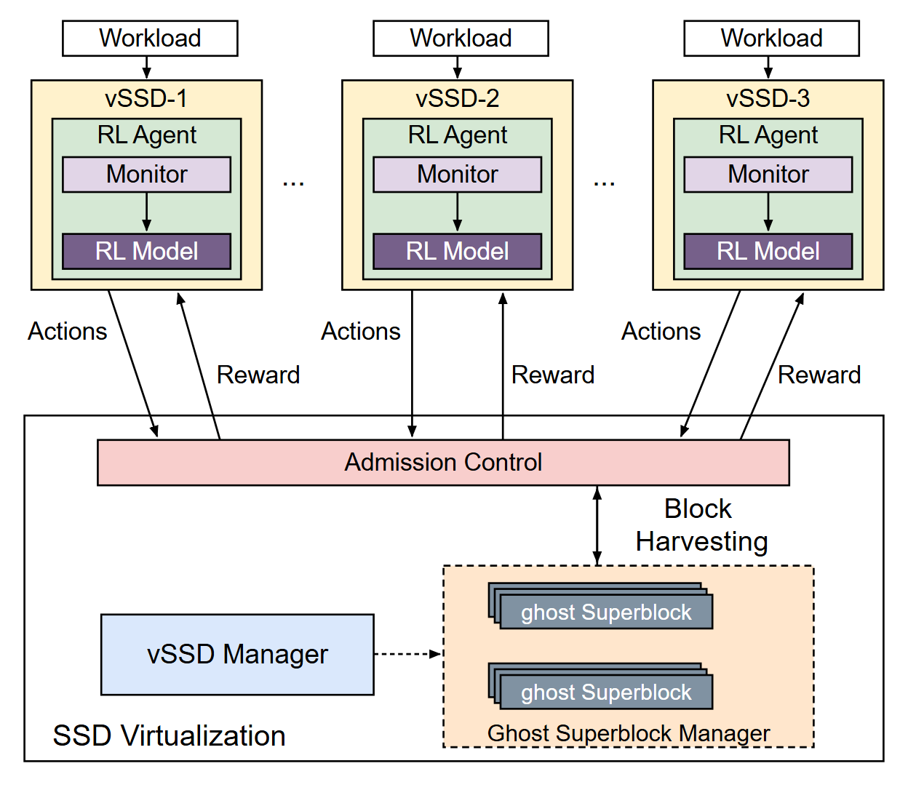

# VA-004 · 多主体反馈与共享资源调度

三列自治主体分别接收任务，在内部完成观测与策略选择，再经同一准入环节操作共享资源。成对的向下动作和向上反馈让局部决策与全局执行形成闭环，适合强调分散决策、集中约束的系统。



## 适用范围

- 三个代表性主体共享受限资源的控制系统
- 需要同时说明观测、决策、准入和资源管理的方案

不适合：只有单向任务流水线的流程；要求任意主体数自动排版的图。

## 阅读顺序

1. 先看三列任务入口与黄色主体边界。
2. 沿内部箭头从观测块读到深色策略块。
3. 对照动作下行和反馈上行，定位共享准入横条。
4. 最后看底部管理者、逻辑资源池及两组叠片。

## 图形表达

**布局**：上部等宽三列，下部通栏基础设施；窄准入条对齐各列回路。

**对象**：矩形嵌套表示所属，叠片表示成组资源；省略号说明重复模式。

**连线**：外侧回路有意倾斜，内部观测线竖直；不要把反馈线接成单向链。

**配色**：浅黄分主体、浅绿包决策区、紫色区分观测与策略；粉色只标共享准入。

**文字**：Arial 无衬线；策略白字需保持深底对比，资源标签比主体名更小。

## 部件与复用

| 部件 | 含义 | 改造方法 |
|---|---|---|
| 第1列任务入口 (`workload-0`) | 本列请求来源。 | 换任务名，与本列主体对应。 |
| 第1列主体边界 (`agent-0`) | 本地观测及决策的范围。 | 保留嵌套；增列需改代码。 |
| 第1列决策区域 (`rl-agent-0`) | 主体内部工作范围。 | 固定 RL Agent 标题须改代码。 |
| 第1列状态观测 (`monitor-0`) | 从输入提取状态。 | 填实际观测器名。 |
| 第1列策略选择 (`policy-0`) | 由状态产生动作。 | 改算法名并检查深底白字。 |
| 第2列任务入口 (`workload-1`) | 本列请求来源。 | 换任务名，与本列主体对应。 |
| 第2列主体边界 (`agent-1`) | 本地观测及决策的范围。 | 保留嵌套；增列需改代码。 |
| 第2列决策区域 (`rl-agent-1`) | 主体内部工作范围。 | 固定 RL Agent 标题须改代码。 |
| 第2列状态观测 (`monitor-1`) | 从输入提取状态。 | 填实际观测器名。 |
| 第2列策略选择 (`policy-1`) | 由状态产生动作。 | 改算法名并检查深底白字。 |
| 第3列任务入口 (`workload-2`) | 本列请求来源。 | 换任务名，与本列主体对应。 |
| 第3列主体边界 (`agent-2`) | 本地观测及决策的范围。 | 保留嵌套；增列需改代码。 |
| 第3列决策区域 (`rl-agent-2`) | 主体内部工作范围。 | 固定 RL Agent 标题须改代码。 |
| 第3列状态观测 (`monitor-2`) | 从输入提取状态。 | 填实际观测器名。 |
| 第3列策略选择 (`policy-2`) | 由状态产生动作。 | 改算法名并检查深底白字。 |
| 共享执行系统 (`shared-system`) | 准入与资源管理的运行边界。 | 改共享设施名，保留主体在边界外。 |
| 动作准入闸门 (`admission`) | 集中筛选或排序动作。 | 无统一准入时需拆横条及回路。 |
| 资源管理者 (`manager`) | 管理资源记录的蓝色块。 | 虚线为管理关系，需写明。 |
| 逻辑资源池 (`resource-pool`) | 虚线包围的资源集合。 | 若改实体设备，边界用实线。 |
| 第一资源组 (`resource-0`) | 相似对象的叠片记录。 | 改类别，叠片数不代表容量。 |
| 第二资源组 (`resource-1`) | 与上组并列的另一资源。 | 保持标签区分；增组需扩池。 |

## 改造步骤

1. 先确定三个主体与两个资源组是否能真实代表新系统。
2. 同步改动作、反馈、资源分配三类标签，使方向与含义一致。
3. 若使用规则控制，改代码中的固定 RL Agent 标题。
4. 主体增减须同时改坐标、箭头路径和省略号位置。

## 新情景示例（假设）

假设绘制三园区充电调度。

三列对应园区，观测为排队与负荷，策略为充电配额；共享准入执行电网容量限制。

两组资源改成快充和慢充端口记录；反馈改成服务率，避免继续写奖励。

## 编辑入口

**入口**：make_figure.py 的 build(c) 生成原生 SVG；example.json 提供 agents、resources 及共享模块标签。

**配置可改**：agents 可改 name/input/monitor/policy；admission、manager、pool_name、system_name 和三类连线标签可配置。

**需改代码**：代码严格要求 3 个 agents、2 个 resources；布局、颜色、RL Agent 固定标题和新连接须修改 build()，不支持自动增列。

**字体**：当前只支持 reference-system 配置的系统 Arial；运行时检查可用性，PDF 导出需确认嵌入，不能宣称已支持便携字体。

准备独立工作副本：

```text
python "<SKILL>/scripts/prepare_architecture.py" --id VA-004 --out figures/architecture
```

在工作副本运行：

```text
python make_figure.py --config example.json --out . --parts
python render_architecture.py fig.svg
```

## 本图检查

- 三列上下行箭头是否各自接到同一主体，且不穿过标签。
- 准入与资源池的双向关系是否确实存在。
- 资源叠片的有意重叠是否仍保留完整前层标签。

部件图用于复用局部对象；跨边界的连接和共享容器仍需按新关系处理。示例名称、数值和曲线不是当前研究结果。

来源与许可见 [ATTRIBUTION.md](ATTRIBUTION.md)。
