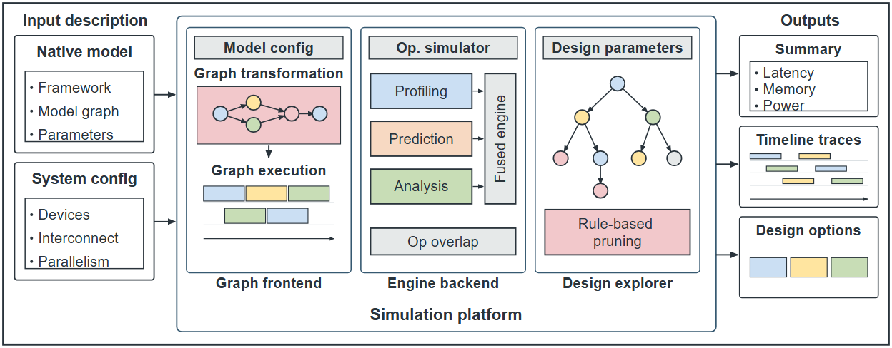

# VA-003 · 双侧输入输出包围的多机制平台

窄输入列和输出列夹住主平台，平台内三块分别用关系图、并列评估器和搜索树解释不同机制。外框强调系统完整性，内部异构画法承担信息密度，不能把全部模块统一成只有标题的空框。



## 适用范围

- 输入条件经多种互补机制产生多类输出的平台
- 需要将整体系统和少量内部细节放在一张宽图

不适合：三个模块实际只是同质串行步骤；没有搜索过程却想保留树形装饰。

## 阅读顺序

1. 先看左边对象和条件两组输入。
2. 中央依次读关系变换、多方法评估和候选探索。
3. 右边核对指标、时序和候选三类输出。

## 图形表达

**布局**：两侧窄列围绕三块等宽模块，主平台用独立边界包围，标题置于模块下方。

**对象**：文档、节点图、时间条、引擎列与树形对象各自编码不同产物。

**连线**：两侧短箭头仅连平台；模块相邻不等于已声明直接数据流，若需要应显式补边。

**配色**：灰条为标题和融合结构；蓝、桃、绿区分评估器，粉色突出变换或约束。

**文字**：短粗标题加内部较小标签；竖排融合标签空间有限，长词宜改横向布局。

## 部件与复用

| 部件 | 含义 | 改造方法 |
|---|---|---|
| 对象输入框 (`input-0`) | 描述待处理对象。 | 改标题并同步内容对象。 |
| 对象文档 (`input-object-0`) | 列出对象结构与参数。 | 替换文档条目或 glyph 类型。 |
| 条件输入框 (`input-1`) | 描述设备与约束。 | 与对象输入分开。 |
| 条件文档 (`input-object-1`) | 列出配置条件。 | 逐项改为真实约束。 |
| 平台边界 (`platform`) | 包含三个不同内部机制。 | 变更模块数须改布局。 |
| 变换模块 (`module-0`) | 对象转成中间结构与执行表示。 | 改 section_labels 与内部对象。 |
| 图变换区域 (`module-0-graph`) | 承载节点关系。 | 改背景及图对象。 |
| 节点关系图 (`module-0-graph-object`) | 具体拓扑及类别。 | 用 nodes 和 edges 改关系。 |
| 中间产物 (`module-0-artifact`) | 显示变换后的时间或序列结构。 | 按真实输出换 glyph。 |
| 多方法评估模块 (`module-1`) | 并列方法进入融合。 | 改 engines 与结果处理。 |
| 第一评估器 (`engine-0`) | 第一类估计依据。 | 换方法名与角色色。 |
| 第二评估器 (`engine-1`) | 第二类估计依据。 | 不要只换同义标签。 |
| 第三评估器 (`engine-2`) | 第三类估计依据。 | 缺此方法时调整引擎区几何。 |
| 融合接口 (`fusion`) | 接收多个估计。 | 说明融合含义。 |
| 后处理 (`postprocess`) | 处理融合后的额外关系。 | 换为实际后处理。 |
| 候选探索模块 (`module-2`) | 用树表达分支候选。 | 不做搜索时替换该机制。 |
| 搜索树 (`module-2-search`) | 分支与候选关系。 | 配置节点边并解释裁剪。 |
| 规则框 (`search-rule`) | 约束候选保留条件。 | 替换真实筛选规则。 |
| 指标输出框 (`output-0`) | 汇总数值类产物。 | 改标题与内文。 |
| 指标文档 (`output-object-0`) | 列出输出指标。 | 写指标名和单位。 |
| 时序输出框 (`output-1`) | 展示安排类产物。 | 无时序输出时改类型。 |
| 时间条对象 (`output-object-1`) | 任务先后与持续时间。 | 示意条不能当计算结果。 |
| 方案输出框 (`output-2`) | 展示候选选择。 | 明确方案是什么。 |
| 方案槽位 (`output-object-2`) | 并列显示候选项。 | 换真实类别及数量。 |

## 改造步骤

1. 先确定三种机制是否真实存在，再选 transform、engines、search 布局。
2. 内部图与产物必须随任务改造，不能只替换外层标题。
3. 输出类型改变时更换 object.kind 和内容；两侧项目过多须扩展画布。

## 新情景示例（假设）

假设展示交通应急方案评估平台。

输入为路网与封路条件，第一模块生成可行路网，第二模块融合仿真与解析评估，第三模块探索调度方案。

重新配置路网 nodes/edges 和方案树；时序条改成车辆任务安排，删去不存在的评估器。

## 编辑入口

**入口**：make_figure.py 的 build(c) 构图，example.json 提供 inputs、modules、outputs 和 platform_name。

**配置可改**：可配图对象、标题、engines、fusion、postprocess、rule 及 palette；模块 layout 支持 transform、engines、search。

**需改代码**：代码明确要求 modules 数量等于 3；改模块数、双侧数量间距或加入模块间边须编辑 build，现有布局不会自动扩展。

**字体**：diagram.py 声明 Arial, sans-serif；保留标题与内部标签的字号层次，按最终宽度检查并列模块和竖排融合文字，跨设备导出需核实实际字体。

准备独立工作副本：

```text
python "<SKILL>/scripts/prepare_architecture.py" --id VA-003 --out figures/architecture
```

在工作副本运行：

```text
python make_figure.py --config example.json --out . --parts
python render_architecture.py fig.svg
```

## 本图检查

- 三模块名称是否对应实际内部对象而非抽象口号。
- 融合侧栏是否被长文字挤出引擎区域。
- 输入输出数量变化后是否超出固定高度及外框。

部件图用于复用局部对象；跨边界的连接和共享容器仍需按新关系处理。示例名称、数值和曲线不是当前研究结果。

来源与许可见 [ATTRIBUTION.md](ATTRIBUTION.md)。
