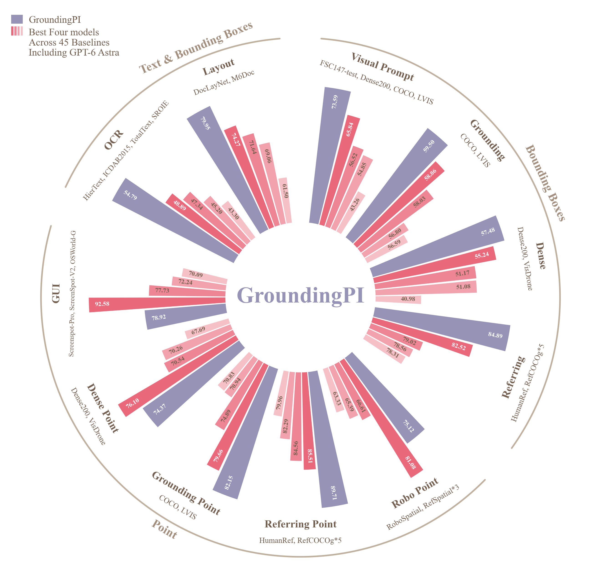

# 环形分组柱状对比图

模板 148 · `advanced.grouped_radial_bar`

标签：比较、极坐标、分组、层级

## 用途与数据

同一任务中，重点方法与多个基线的表现如何？同时展示任务与大类的层级。

- 2–16个任务、2–8个方法，最多96根柱；有限非负数值
- 数值宽表与任务、大类、说明表；任务名称唯一且一一对应，同一大类连续排列
- 参考默认按任务独立缩放柱长，只能组内比较；跨任务读取原始数值或在源码中选择共享尺度

## 结构与视觉特点

宽重点柱与窄基线柱；组间留白和中心留白；逐柱原始数值与沿圆周文字；外圈层级分类弧线；重点色与基线同色系梯度。

## 数值口径与来源

按用户参考图重建布局；演示数值逐项从图片读入，未独立核验原实验。参考模式把每任务最小、最大值映射到固定柱长区间，不表示跨任务绝对值或面积比例。配色读取项目粉彩少女及其他色板。

[完整源码](../sources/advanced.grouped_radial_bar/original.py) · [使用说明](../sources/advanced.grouped_radial_bar/recipe.md) · [来源](../sources/advanced.grouped_radial_bar/SOURCE.md)

## 源码保真要点

保留宽重点柱、基线色阶、组间间距、中心留白、原始数值、旋转任务名和说明、大类弧线及图例；不能用单系列玫瑰图代替。

可替换任务、方法、分组、说明、中心文字与配色。默认任务内缩放只能用于组内比较；跨任务比较改用共享尺度并明确说明，不排序或遗漏输入方法。

- 源码定位：[sources/advanced.grouped_radial_bar/original.html#L213](../sources/advanced.grouped_radial_bar/original.html#L213)
- 源码定位：[sources/advanced.grouped_radial_bar/original.html#L183](../sources/advanced.grouped_radial_bar/original.html#L183)
- 源码定位：[sources/advanced.grouped_radial_bar/original.html#L165](../sources/advanced.grouped_radial_bar/original.html#L165)
- 源码定位：[sources/advanced.grouped_radial_bar/original.html#L188](../sources/advanced.grouped_radial_bar/original.html#L188)
- 源码定位：[sources/advanced.grouped_radial_bar/original.html#L234](../sources/advanced.grouped_radial_bar/original.html#L234)
- 源码定位：[sources/advanced.grouped_radial_bar/original.html#L197](../sources/advanced.grouped_radial_bar/original.html#L197)
