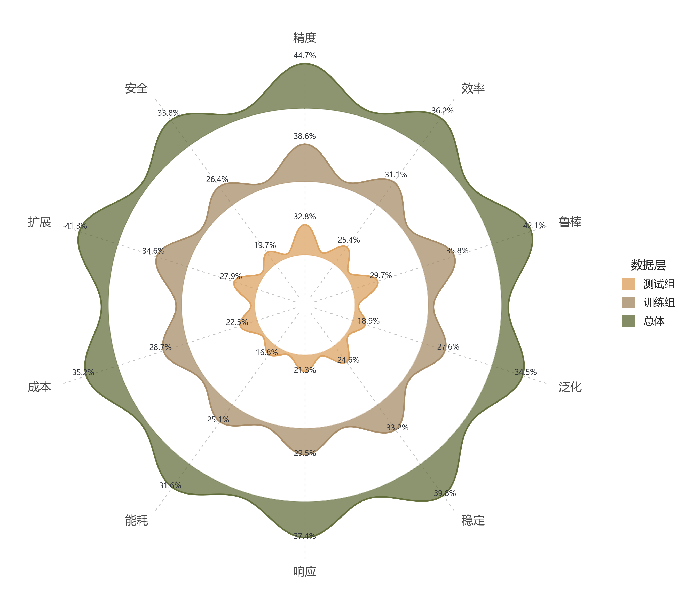

# 雷达山脊融合图

模板147 · `advanced.radar_ridgeline`

标签：极坐标、多维、比较、融合

## 用途与数据

多个数据层在一组有序指标上的相对高低和轮廓差异如何？

- 5–16个唯一指标及一致排列顺序
- 2–4个同尺度数据层；成本型指标先统一方向

## 结构与视觉特点

径向虚线雷达骨架、同心独立基准环、指标方向平滑局部峰、半透明填充与同色轮廓、逐峰数值和外围指标名。

## 适配和来源

仅效果图重建；演示值为人工构造。峰高使用全部数据共同归一化，峰宽固定。山脊不是KDE，不表达样本分布、样本量或不确定性。

[完整源码](../sources/advanced.radar_ridgeline/original.py) · [来源与编码](../sources/advanced.radar_ridgeline/SOURCE.md) · [参考图](../sources/advanced.radar_ridgeline/reference.jpg)

## 源码保真要点

保留每层独立基准圆环、指标方向平滑局部峰、半透明填充与同色轮廓、径向虚线、逐峰数值和外置图例；所有层使用同一个全局归一化尺度。

可替换指标、数据层、数值、数值后缀与项目配色；可按类别数调整峰宽及画布。不能将各层分别归一化后声称环间峰高可比，也不能把标量峰描述为样本密度。

- 源码定位：[sources/advanced.radar_ridgeline/original.html#L96](../sources/advanced.radar_ridgeline/original.html#L96)
- 源码定位：[sources/advanced.radar_ridgeline/original.html#L97](../sources/advanced.radar_ridgeline/original.html#L97)
- 源码定位：[sources/advanced.radar_ridgeline/original.html#L103](../sources/advanced.radar_ridgeline/original.html#L103)
- 源码定位：[sources/advanced.radar_ridgeline/original.html#L109](../sources/advanced.radar_ridgeline/original.html#L109)
- 源码定位：[sources/advanced.radar_ridgeline/original.html#L121](../sources/advanced.radar_ridgeline/original.html#L121)
