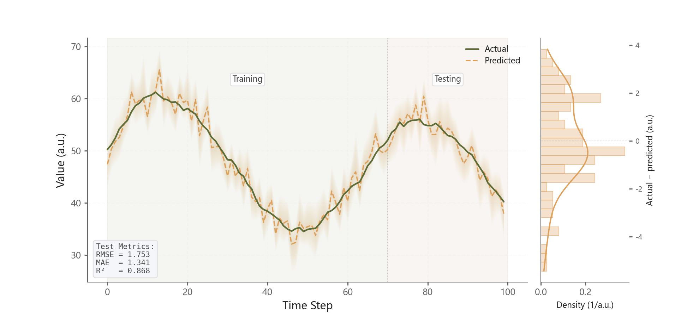

# 059 · 时序预测与误差侧分布

ID：`empirical.prediction_ci`

用途：预测跟踪真实走势怎样，误差分布如何？

标签：预测、误差、组合

别名：时序预测与误差侧分布

## 数据要求

- 有序真实值、预测值、预测区间
- 可选：真实训练测试分界或已定义评估方案

## 组合结构

左时序实际与预测；右竖向误差直方与密度

## 视觉特点

- 透明预测带
- 训练测试背景
- 误差指标框

## 适配注意

右侧是残差分布，必须独立于左侧预测量的纵轴范围和刻度，不能使用sharey连接两者。训练测试划分为条件构件：没有真实标签或既定评估方案时不绘制，不自行补比例；多方法分别计算并标明指标及有效样本数，不将方法重复观测混算为一个评价值。

## 预览

## 来源与核对

原名称：Prediction vs Actual with CI Band
原始代码：[查看](../sources/empirical.prediction_ci/original.html)
预览范围：首个主要Python示例
已查看对应预览并核对主要绘图和数据代码；卡片不是统计有效性认证。

## 相近候选

- [历史与预测分位数扇形图](advanced.fan.md)
- [概率校准与预测概率分布](advanced.calibration.md)
- [预测对实际散点与下方残差分布](competition.prediction_actual.md)

<!-- fidelity:start -->
## 源码保真要点

以当前完整配方源码为底稿；下列行号指向解释预览的快照。数据适配不应顺手删掉这些视觉结构。

### 预测带与侧边误差分布

- 保留重点：保留主图逐层叠加的透明预测带（本示例为12层alpha=0.025）、实际/预测线型区分，以及右侧竖向误差直方和密度；不能把分层带直接替换成一次实色填充。 侧栏保留独立数值刻度和残差单位；演示为任意单位a.u.，接入数据时替换为实际单位。
- 可适配：真实区间端点决定色带外边界，内层仅表示视觉渐变，不宣称额外置信水平。仅有真实训练/测试标签或已定义的评估方案时保留分界；没有时移除这组背景、分界和训练/测试文字，不自行发明70/30或80/20划分。指标使用明确的真实样本范围，多方法分别计算并标明n、MAE和RMSE；不得把多个方法的同一批观测合并冒充独立样本。多站点可复用主图＋误差侧栏并留足轴标签间距；残差纵轴和预测量纵轴独立设置，保留各自可读的数值刻度与单位。
- 源码：[L19–19](../sources/empirical.prediction_ci/original.html#L19) · [L20–20](../sources/empirical.prediction_ci/original.html#L20) · [L30–31](../sources/empirical.prediction_ci/original.html#L30) · [L33–33](../sources/empirical.prediction_ci/original.html#L33) · [L34–34](../sources/empirical.prediction_ci/original.html#L34) · [L49–49](../sources/empirical.prediction_ci/original.html#L49) · [L51–51](../sources/empirical.prediction_ci/original.html#L51) · [L54–57](../sources/empirical.prediction_ci/original.html#L54)

按现有审图流程对照实际输出；有疑问时可用[源码差异提示](../../template-fidelity.md)。
